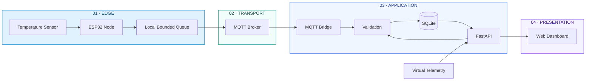
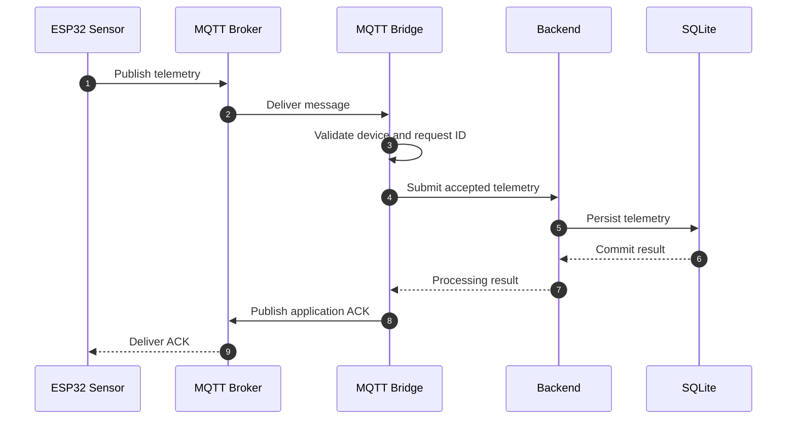

# MW-SENSE

### Modular Wireless Sensor Network & Telemetry Platform

<p align="center">
  <strong>An IoT telemetry platform for connected devices, real-time monitoring, and reliable data ingestion.</strong>
</p>

<p align="center">
  
  
  
  
  
</p>

<p align="center">
  <a href="#architecture">Architecture</a> ·
  <a href="#how-it-works">How it works</a> ·
  <a href="#getting-started">Getting started</a> ·
  <a href="#verification">Verification</a>
</p>

---

## The idea

MW-SENSE connects physical sensor devices to a centralized telemetry platform.

It provides the software infrastructure required to receive sensor readings, transport messages, validate device data, persist measurements, and make system information accessible through a monitoring dashboard.

Instead of treating an IoT device, backend, and dashboard as separate applications, MW-SENSE brings them together through defined communication and data contracts.

**The objective is simple: make distributed sensor data observable, manageable, and accessible through one coherent system.**

## At a glance

| | |
|---|---|
| **Device layer** | ESP32-based sensor nodes |
| **Communication** | MQTT |
| **Application backend** | FastAPI |
| **Persistence** | SQLite |
| **User interface** | Browser-based dashboard |
| **Development mode** | Physical and virtual telemetry |
| **Primary concern** | Device telemetry ingestion and monitoring |

---

## Architecture

The system is divided into four logical layers.

<p align="center">
  
</p>

### System architecture



### Layer responsibilities

| Layer | Responsibility |
|---|---|
| Edge | Acquire sensor readings and prepare device messages |
| Transport | Transfer messages using MQTT |
| Application | Validate, process, and persist telemetry |
| Presentation | Display device and telemetry information |

The architecture keeps physical device communication separate from application-level processing. This makes the backend easier to develop and test without requiring a connected sensor network.

---

## How it works

MW-SENSE supports two telemetry paths.

### 1. Physical telemetry



**Processing sequence**

1. ESP32 collects a sensor measurement.
2. Firmware creates a telemetry message with device, sensor, and request identifiers.
3. The device publishes the message to its MQTT topic.
4. The MQTT bridge receives and validates the message.
5. The backend processes and persists accepted telemetry.
6. The bridge publishes an application-level acknowledgement.
7. The device can use the acknowledgement to manage its pending message.

### 2. Virtual telemetry

Physical hardware should not be a prerequisite for every development activity.

MW-SENSE also provides a virtual telemetry path:


Virtual telemetry is useful for:

- Dashboard development.
- Backend testing.
- Demonstrations.
- Testing application workflows without hardware.
- Reproducing telemetry scenarios.

Virtual measurements remain distinguishable from physical device measurements.

---

## Telemetry flow — animated overview

<p align="center">
  
</p>

The animation illustrates the system's primary data path:

**ESP32 → MQTT → FastAPI → SQLite → Dashboard**

A separate virtual telemetry source enters at the application layer.

> Add the animated GIF to `docs/assets/mw-sense-flow.gif` to activate this section. GitHub README files support animated GIFs as image assets.

---

## Core engineering concepts

### Telemetry ingestion

The ingestion workflow is responsible for accepting structured telemetry, validating incoming data, and persisting accepted records.

### Message identity and duplicate protection

Each telemetry request uses a stable request identifier. Database uniqueness constraints help protect against duplicate records when messages are redelivered.

### Application acknowledgements

MQTT transport delivery and application processing are different events.

MW-SENSE uses application-level acknowledgements to communicate the processing result associated with a telemetry request.

### Device status

The platform processes device status and heartbeat messages. Device offline state is derived when device information is requested, using the configured offline threshold.

### Bounded local storage

The ESP32 reference implementation uses bounded local queue storage to retain pending messages within its supported firmware workflow.

### Important delivery distinction

The current firmware publishes telemetry using MQTT QoS 0. The bridge subscribes to telemetry and status topics using QoS 1 and publishes application acknowledgements using QoS 1.

Stable request identifiers and database uniqueness constraints help support safe redelivery.

This is not an exactly-once delivery guarantee across the complete device-to-database pipeline.

---

## Technology stack

| Component | Technology |
|---|---|
| Edge hardware | ESP32 |
| Firmware development | PlatformIO |
| Communication protocol | MQTT |
| Backend framework | FastAPI |
| Runtime | Python |
| ASGI server | Uvicorn |
| Database | SQLite |
| Frontend | JavaScript |
| Testing | Pytest and JavaScript test tooling |

---

## Repository structure

```text
MW-SENSE/
│
├── backend/
│   ├── tests/
│   ├── mqtt_bridge.py
│   └── requirements.txt
│
├── firmware/
│   └── ESP32 reference implementation
│
├── scripts/
│
├── dashboard/
│
├── docs/
│   └── assets/
│       ├── mw-sense-architecture.png
│       └── mw-sense-flow.gif
│
├── package.json
└── README.md
```

The tree highlights the main system areas. Consult the repository for the complete current directory inventory.

---

## Getting started

### Prerequisites

- Python 3.12
- Node.js 22
- npm
- Git
- PlatformIO for firmware development
- An MQTT broker for physical device integration

### 1. Clone

```bash
git clone https://github.com/chamanvashishth/MW-SENSE.git
cd MW-SENSE
```

### 2. Backend dependencies

Create a virtual environment:

**Windows PowerShell**

```powershell
python -m venv .venv
.venv\Scripts\Activate.ps1
```

**Linux / macOS**

```bash
python3 -m venv .venv
source .venv/bin/activate
```

Install dependencies:

```bash
pip install -r backend/requirements.txt
```

Start the FastAPI application using the ASGI entry point defined by the current backend implementation.

### 3. Dashboard dependencies

```bash
npm install
```

Use the development script defined in `package.json` to start the dashboard.

The dashboard and backend run as separate processes. Configure their API origin appropriately.

### 4. Firmware

Install PlatformIO and build the ESP32 reference firmware:

```bash
pio run
```

Physical deployment additionally requires compatible hardware, sensor wiring, Wi-Fi configuration, and MQTT broker credentials.

---

## Configuration

The backend supports environment-based configuration.

| Environment variable | Purpose |
|---|---|
| `MW_SENSE_API_TOKEN` | Optional API token authentication |
| `MW_SENSE_DB_PATH` | SQLite database path |
| `MW_SENSE_ALLOWED_ORIGINS` | Allowed browser origins |
| `MW_SENSE_RETENTION_DAYS` | Telemetry retention configuration |
| `MW_SENSE_DEVICE_OFFLINE_SECONDS` | Device offline threshold |
| `MW_SENSE_QUEUE_WARNING_DEPTH` | Queue warning threshold |
| `MW_SENSE_RETRY_WARNING_COUNT` | Retry warning threshold |
| `MW_SENSE_WEAK_WIFI_RSSI_DBM` | Weak Wi-Fi signal threshold |
| `MW_SENSE_PENDING_WARNING_SECONDS` | Pending-message warning threshold |

Example development configuration:

```env
MW_SENSE_API_TOKEN=replace-with-a-secure-token
MW_SENSE_DB_PATH=./data/mw-sense.db
MW_SENSE_ALLOWED_ORIGINS=http://localhost:3000
MW_SENSE_RETENTION_DAYS=30
MW_SENSE_DEVICE_OFFLINE_SECONDS=120
MW_SENSE_QUEUE_WARNING_DEPTH=20
MW_SENSE_RETRY_WARNING_COUNT=5
MW_SENSE_WEAK_WIFI_RSSI_DBM=-75
MW_SENSE_PENDING_WARNING_SECONDS=60
```

These are illustrative settings. Production values should be selected according to the deployment environment.

---

## MQTT topic contract

The bridge uses the following topic structure:

| Topic | Direction | Purpose |
|---|---|---|
| `mw-sense/{node_id}/{sensor_id}/telemetry` | Device → backend | Sensor telemetry |
| `mw-sense/{node_id}/status` | Device → backend | Device status and heartbeat |
| `mw-sense/{node_id}/{sensor_id}/ack/{request_id}` | Backend → device | Application acknowledgement |

### MQTT configuration

The bridge requires an MQTT host.

| Setting | Behaviour |
|---|---|
| `MW_SENSE_MQTT_HOST` | Broker host |
| `MW_SENSE_MQTT_PORT` | Broker port; defaults to `8883` |
| `MW_SENSE_MQTT_TLS` | TLS enabled by default |

The bridge enforces a bounded JSON payload size of 4096 bytes.

Physical telemetry must satisfy device validation requirements and include a stable request identifier.

---

## Verification

MW-SENSE separates verification by component.

| Check | Command | Purpose |
|---|---|---|
| Frontend checks | `npm run check` | JavaScript validation |
| Frontend tests | `npm test` | JavaScript regression tests |
| Backend tests | `python -m pytest backend/tests -q` | Backend regression tests |
| Firmware build | `pio run` | ESP32 firmware compilation |

Additional browser and native offline-queue checks are available in the repository.

A passing test suite for one component does not establish end-to-end correctness across hardware, messaging, persistence, and dashboard layers. Report only checks that have actually been executed.

---

## Security and operational boundaries

MW-SENSE is a reference implementation, not a production security certification.

Before deploying beyond a trusted development environment:

- Configure API authentication.
- Use TLS for MQTT connections.
- Use unique device credentials.
- Restrict broker topics using ACLs.
- Keep secrets out of source control.
- Configure browser origins deliberately.
- Establish database backup and recovery procedures.
- Define retention and storage monitoring policies.
- Validate physical sensor calibration.
- Test reconnect, retry, and offline scenarios.

If `MW_SENSE_API_TOKEN` is not configured, token-based authentication is disabled.

CORS is not an authentication mechanism. Simulated telemetry is not a substitute for calibrated physical measurements.

The current ESP32 reference implementation supports a temperature sensor adapter. Additional sensor types require their own firmware integration and validation.

---

## Engineering principles

MW-SENSE is developed around a few core principles:

**Separation of concerns**  
Device acquisition, transport, application processing, persistence, and presentation remain distinct responsibilities.

**Explicit contracts**  
Telemetry messages, device identities, request identifiers, and acknowledgement topics should have clear definitions.

**Observable behaviour**  
Device state, pending messages, telemetry records, and processing outcomes should be inspectable.

**Testable components**  
Backend, dashboard, firmware, and transport behaviour should be verifiable independently.

**Honest delivery guarantees**  
The system should document what it guarantees and what still depends on the device, broker, and deployment environment.

---

## Roadmap

Potential engineering extensions include:

- Additional sensor adapters.
- Stronger device provisioning and credential lifecycle management.
- More comprehensive end-to-end telemetry tests.
- Expanded offline and reconnect testing.
- Deployment observability and structured logging.
- Scalable persistence and retention strategies.
- More detailed device health diagnostics.

These are extension areas, not claims that the functionality is already implemented.

---

## Contributing

Contributions should preserve the system's separation of responsibilities and maintain compatibility with established telemetry contracts.

Before submitting a change:

1. Understand the affected component.
2. Review existing implementation and tests.
3. Keep changes scoped to a clear responsibility.
4. Add regression coverage.
5. Run the relevant verification commands.
6. Document configuration or contract changes.

For substantial changes, include the motivation, architectural impact, verification performed, and operational trade-offs.

---

## License

Refer to the repository's `LICENSE` file for the applicable licensing terms.

---

<p align="center">
  <strong>MW-SENSE</strong><br/>
  Modular Wireless Sensor Network & Telemetry Platform
  <br/><br/>
  <sub>From edge acquisition to observable telemetry.</sub>
</p>
