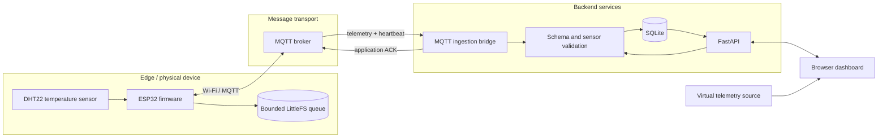

# MW-SENSE

**Modular Wireless Sensor Network and Environmental Monitoring**

MW-SENSE is an IoT monitoring reference implementation that brings together a browser-based telemetry lab, a validated ingestion API, SQLite persistence, an optional MQTT bridge, and ESP32 reference firmware. The repository is structured to make the telemetry path inspectable—from a device measurement or simulated sample through validation and storage to dashboard presentation.

The project is under active development. The dashboard and backend can be exercised locally without physical hardware. The ESP32 firmware and MQTT integration provide a reference path for device integration; they should be treated as unverified until tested with the target board, sensor, broker, and deployment environment.

## Project status

| Area | Current implementation |
|---|---|
| Dashboard | Static HTML, CSS, and JavaScript application with virtual telemetry workflows |
| Telemetry core | Browser-side validation and simulation pipeline |
| API | FastAPI endpoints for telemetry, device registration, heartbeats, diagnostics, and credential lifecycle |
| Persistence | SQLite with schema version records, telemetry indexing, and request-ID uniqueness |
| MQTT integration | Optional Paho-based bridge for authenticated device telemetry and heartbeat ingestion |
| Firmware | PlatformIO ESP32 reference firmware with DHT22 temperature adapter and bounded LittleFS queue |
| Verification | Node.js tests, Python API/bridge tests, Chromium smoke tests, firmware compilation, and native queue tests in CI |

The table describes code present in the repository; it is not a statement that a complete physical deployment has been commissioned.

## System architecture



### Data paths

**Physical telemetry**

1. The ESP32 reads the configured temperature sensor and assigns a stable request ID to the sample.
2. A sample is written to the bounded local queue before transmission.
3. The firmware publishes telemetry to the MQTT broker. The bridge validates topic identity, device credential, request ID, payload shape, sensor assignment, units, and configured value range.
4. Accepted data is inserted into SQLite. The request ID has a unique index, making a redelivery safe to recognize as an existing record.
5. The bridge publishes an application-level acknowledgement. The device removes the matching queue head only after receiving its acknowledgement.

**Virtual telemetry**

The browser application can generate demonstration readings and run them through its virtual pipeline. Data can remain browser-local or be sent to the API. Simulated records carry a `simulation` marker; they must not be treated as physical measurements.

### Delivery model

The firmware telemetry publish uses MQTT QoS 0. The bridge sends a separate application acknowledgement at QoS 1 after database ingestion or duplicate recognition. Stable request IDs and database uniqueness support safe retries, but this is an **at-least-once retry design**, not an end-to-end exactly-once delivery guarantee.

## Repository structure

```text
MW-SENSE/
├── index.html
├── styles.css
├── app.js
├── telemetry-core.js
├── package.json
├── backend/
│   ├── main.py
│   ├── schemas.py
│   ├── database.py
│   ├── backup.py
│   ├── mqtt_bridge.py
│   ├── requirements.txt
│   ├── requirements-dev.txt
│   ├── requirements-mqtt.txt
│   └── tests/
├── firmware/
│   └── esp32/
│       ├── include/
│       ├── src/
│       ├── test/
│       └── platformio.ini
├── tests/
├── docs/
│   ├── DEPLOYMENT_CHECKLIST.md
│   └── assets/animations/
└── .github/workflows/ci.yml
```

| Component | Responsibility |
|---|---|
| `app.js` | Dashboard interaction and application orchestration |
| `telemetry-core.js` | Reusable browser-side telemetry and simulation logic |
| `backend/main.py` | FastAPI application, routes, auth dependency, CORS, and lifecycle |
| `backend/schemas.py` | Pydantic request/response models and sensor catalogue |
| `backend/database.py` | SQLite schema, telemetry persistence, device state, credentials, and lifecycle records |
| `backend/mqtt_bridge.py` | MQTT topic parsing, device authentication, ingestion, heartbeat processing, and acknowledgements |
| `firmware/esp32/src/` | ESP32 application and sensor/transport workflow |
| `firmware/esp32/include/` | Firmware interfaces and private configuration template |
| `docs/DEPLOYMENT_CHECKLIST.md` | Pre-pilot security, recovery, broker, hardware, and operational checks |

## Requirements

For the dashboard and API:

- Git
- Python 3.12 (the version used by CI)
- Node.js 22 for JavaScript checks and tests
- A modern browser

For optional MQTT integration:

- An MQTT broker reachable by the bridge
- The optional dependencies in `backend/requirements-mqtt.txt`

For firmware builds:

- PlatformIO Core
- A supported ESP32 development board
- The sensor and wiring described in the [firmware guide](firmware/esp32/README.md)

## Local development

The current repository does not provide a combined development launcher. Run the API and static dashboard as separate processes.

### 1. Clone

```bash
git clone https://github.com/chamanvashishth/MW-SENSE.git
cd MW-SENSE
```

### 2. Create a virtual environment and install API dependencies

**Windows PowerShell**

```powershell
py -3.12 -m venv .venv
.\.venv\Scripts\Activate.ps1
python -m pip install --upgrade pip
python -m pip install -r backend/requirements-dev.txt
```

If activation is blocked by the current PowerShell execution policy, allow it for this terminal session only:

```powershell
Set-ExecutionPolicy -Scope Process -ExecutionPolicy Bypass
.\.venv\Scripts\Activate.ps1
```

**Linux / macOS**

```bash
python3.12 -m venv .venv
source .venv/bin/activate
python -m pip install --upgrade pip
python -m pip install -r backend/requirements-dev.txt
```

### 3. Start the API

From the repository root:

```bash
python -m uvicorn backend.main:app --reload --host 127.0.0.1 --port 8001
```

Endpoints:

| Endpoint | Purpose |
|---|---|
| `http://127.0.0.1:8001/health` | Basic liveness response |
| `http://127.0.0.1:8001/docs` | Interactive OpenAPI documentation |
| `http://127.0.0.1:8001/openapi.json` | OpenAPI schema |

### 4. Serve the dashboard

In a second terminal, from the repository root:

```bash
python -m http.server 8000 --bind 127.0.0.1
```

Open `http://127.0.0.1:8000`.

Use the dashboard's data explorer to select API-backed storage and set the API base URL to `http://127.0.0.1:8001`. Browser-local mode can be explored without connecting to the API.

Stop either process with `Ctrl+C`.

## Configuration

The API reads the following environment variables:

| Variable | Purpose | Default |
|---|---|---|
| `MW_SENSE_API_TOKEN` | Bearer token required by protected API routes when set | Unset; token enforcement is disabled |
| `MW_SENSE_DB_PATH` | SQLite database file | `backend/mw_sense.db` |
| `MW_SENSE_ALLOWED_ORIGINS` | Comma-separated CORS origin allowlist | `http://localhost:8000,http://127.0.0.1:8000` |
| `MW_SENSE_RETENTION_DAYS` | Telemetry retention period; zero disables time-based pruning | `0` |
| `MW_SENSE_DEVICE_OFFLINE_SECONDS` | Heartbeat age after which a device is marked offline during device listing | `120` |
| `MW_SENSE_QUEUE_WARNING_DEPTH` | Queue-depth warning threshold | `10` |
| `MW_SENSE_RETRY_WARNING_COUNT` | Retry-count warning threshold | `5` |
| `MW_SENSE_WEAK_WIFI_RSSI_DBM` | Magnitude of weak-signal RSSI threshold | `85` |
| `MW_SENSE_PENDING_WARNING_SECONDS` | Oldest pending sample warning threshold | `900` |

Example (PowerShell):

```powershell
$env:MW_SENSE_API_TOKEN = "replace-with-a-local-development-token"
$env:MW_SENSE_DB_PATH = "$PWD\data\mw_sense.db"
$env:MW_SENSE_ALLOWED_ORIGINS = "http://127.0.0.1:8000"
python -m uvicorn backend.main:app --reload --host 127.0.0.1 --port 8001
```

Example (Linux / macOS):

```bash
export MW_SENSE_API_TOKEN="replace-with-a-local-development-token"
export MW_SENSE_DB_PATH="$PWD/data/mw_sense.db"
export MW_SENSE_ALLOWED_ORIGINS="http://127.0.0.1:8000"
python -m uvicorn backend.main:app --reload --host 127.0.0.1 --port 8001
```

When `MW_SENSE_API_TOKEN` is unset, the API token dependency does not enforce authentication. Set it for any shared environment. Do not embed administrator tokens in public frontend code or commit local secrets.

## API surface

FastAPI exposes interactive documentation at `/docs`. The implemented routes are:

| Method | Route | Access / behavior |
|---|---|---|
| `GET` | `/health` | Basic service health |
| `GET` | `/health/diagnostics` | Protected database and retention diagnostics |
| `GET` | `/sensors` | Protected sensor catalogue |
| `POST` | `/devices` | Register a supported node |
| `GET` | `/devices` | Protected device list and derived health state |
| `POST` | `/devices/{node_id}/heartbeat` | Update device heartbeat/runtime metrics |
| `POST` | `/devices/{node_id}/credentials` | Issue/rotate a device credential; plaintext returned once |
| `DELETE` | `/devices/{node_id}/credentials` | Revoke a device credential |
| `GET` | `/devices/{node_id}/credential-events` | Credential lifecycle history |
| `GET` | `/devices/{node_id}/lifecycle-events` | Device lifecycle history |
| `GET` | `/telemetry` | Filtered, paginated telemetry retrieval |
| `POST` | `/telemetry` | Validate and persist telemetry |
| `DELETE` | `/telemetry` | Clear telemetry records |

Protected routes enforce bearer-token authentication when `MW_SENSE_API_TOKEN` is configured. Telemetry validation is defined centrally in `backend/schemas.py`; the current catalogue maps:

| Parameter | Node | Sensor | Unit | Range |
|---|---|---|---|---|
| `temperature` | `NODE-01` | `TEMP-01` | °C | 0–50 |
| `humidity` | `NODE-01` | `HUM-01` | % | 0–100 |
| `air_quality` | `NODE-02` | `AIR-02` | simulated units | 0–500 |
| `soil_moisture` | `NODE-03` | `SOIL-01` | % | 0–100 |

These are API validation assignments, not evidence that physical drivers exist for each parameter. The current ESP32 reference firmware implements temperature measurement only.

## Optional MQTT bridge

Install the additional dependencies:

```bash
python -m pip install -r backend/requirements-mqtt.txt
```

Configure the bridge environment, then start it from the repository root:

```bash
export MW_SENSE_MQTT_HOST="broker.example.net"
export MW_SENSE_MQTT_PORT="8883"
export MW_SENSE_MQTT_USERNAME="mw-sense-bridge"
export MW_SENSE_MQTT_PASSWORD="replace-me"
export MW_SENSE_MQTT_TLS="true"
python -m backend.mqtt_bridge
```

The bridge uses the same `MW_SENSE_DB_PATH` as the API. It subscribes to:

- `mw-sense/+/+/telemetry`
- `mw-sense/+/status`

Telemetry must identify the same node and sensor in both topic and JSON payload, set `simulation: false`, include a request ID, and present a valid per-device credential. The bridge validates and removes `device_token` before passing the telemetry fields to the API schema/database layer. Heartbeats use the node-specific status topic and the same device credential model.

The bridge uses MQTT TLS by default through the Paho client TLS configuration. Broker identity, certificate trust, ACLs, and network policy remain deployment responsibilities. See the firmware guide and deployment checklist for the device-side TLS and broker policy details.

## ESP32 reference firmware

The firmware project is located at `firmware/esp32`. It targets the PlatformIO `esp32dev` environment and Arduino framework. The reference implementation uses a DHT22 temperature adapter, Wi-Fi, MQTT, NTP time synchronization, a bounded LittleFS queue, stable request IDs, and application-level acknowledgements.

Prepare the private configuration file:

**Windows PowerShell**

```powershell
Copy-Item firmware/esp32/include/config.h.example firmware/esp32/include/config.h
```

**Linux / macOS**

```bash
cp firmware/esp32/include/config.h.example firmware/esp32/include/config.h
```

Configure the board, sensor pin, Wi-Fi, broker, CA certificate, node ID, and provisioned device credential in `firmware/esp32/include/config.h`. This file is ignored by Git; keep secrets out of commits.

Compile from the repository root:

```bash
pio run -d firmware/esp32
```

The firmware setup, provisioning sequence, MQTT topic contract, message format, queue behavior, and known limitations are documented in the [ESP32 firmware guide](firmware/esp32/README.md).

A successful build does not validate wiring, calibration, broker reachability, TLS trust, RF coverage, power behavior, or field reliability.

## Verification

The repository CI workflow defines the following checks. Run them from the repository root.

**JavaScript syntax and tests**

```bash
node --check app.js
node --check telemetry-core.js
npm test
```

**Python backend tests**

```bash
python -m pip install -r backend/requirements-dev.txt
python -m pytest backend/tests -q
```

**Browser smoke tests**

```bash
python -m pip install -r requirements-browser.txt -r backend/requirements.txt
python -m playwright install chromium
python tests/browser_smoke.py
```

**Firmware compile**

```bash
pio run -d firmware/esp32
```

**Native offline-queue tests**

With a C++17 compiler:

```bash
g++ -std=c++17 -Wall -Wextra -Werror \
  -Ifirmware/esp32/test/native/stubs \
  -Ifirmware/esp32/include \
  firmware/esp32/test/native/test_offline_queue.cpp \
  -o mw-sense-offline-queue-tests
./mw-sense-offline-queue-tests
```

CI is configured in [`.github/workflows/ci.yml`](.github/workflows/ci.yml). Automated tests provide evidence about the code paths they exercise; they do not replace target-board or field validation.

## Security and operational boundaries

- Configure `MW_SENSE_API_TOKEN` before exposing protected API operations beyond an isolated local environment.
- Use HTTPS for a hosted API and verified TLS for the MQTT broker.
- Keep administrator and device credentials out of browser bundles, source control, logs, and shared screenshots.
- Issue distinct device credentials and configure broker topic ACLs so a node cannot publish as another node.
- The device credential is returned in plaintext only at issuance/rotation; the backend stores a digest.
- Configure a persistent database path, retention policy, and tested backup/restore process.
- CORS is an origin policy, not authentication or authorization.
- Device offline state is derived when the protected device list is requested; it is not a continuous alerting service.
- Dashboard-generated samples are simulated. The air-quality parameter is expressed in illustrative simulation units, not calibrated ppm.
- The ESP32 reference currently supports the temperature adapter only. Other API catalogue parameters remain software-level examples until hardware adapters are implemented and tested.

For a hosted dashboard, FastAPI service, SQLite storage, and MQTT broker must be deployed as separate services or processes. A static hosting service can publish the dashboard but cannot run the Python API, SQLite process, or MQTT broker.

Before a pilot, work through [`docs/DEPLOYMENT_CHECKLIST.md`](docs/DEPLOYMENT_CHECKLIST.md). It covers security configuration, persistence and recovery, broker ACLs, physical-device verification, dashboard/API behavior, and pilot acceptance criteria.

## Contribution

Keep changes scoped and reviewable. For behavioral changes, update the relevant tests and documentation. For hardware-facing changes, state the board revision, sensor model, wiring, firmware build, and whether the behavior was simulated, compiled, or exercised on physical hardware.

1. Fork the repository and create a focused branch.
2. Implement the change with corresponding tests.
3. Run the relevant checks listed above.
4. Update configuration and operational documentation when interfaces change.
5. Open a pull request with the rationale, scope, and verification evidence.

Do not commit real configuration files, Wi-Fi credentials, broker passwords, API tokens, device credentials, or private keys.

## Documentation

- [ESP32 firmware guide](firmware/esp32/README.md)
- [Deployment readiness checklist](docs/DEPLOYMENT_CHECKLIST.md)
- [FastAPI application](backend/main.py)
- [Request and response schemas](backend/schemas.py)
- [SQLite persistence layer](backend/database.py)
- [MQTT bridge](backend/mqtt_bridge.py)
- [CI workflow](.github/workflows/ci.yml)

## License

See [LICENSE](LICENSE).
