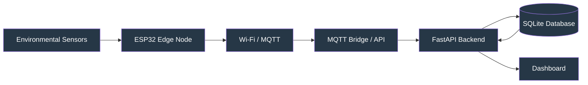
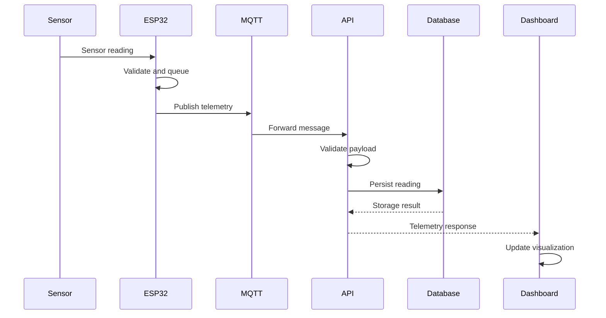
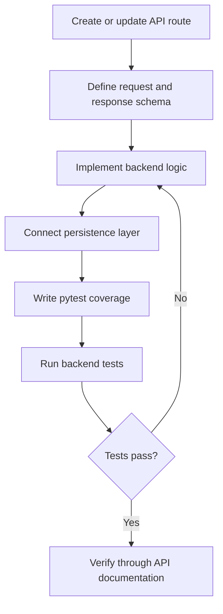
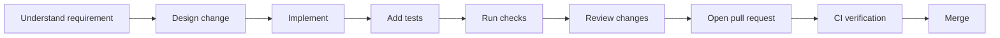

# MW-SENSE

### Modular Wireless Sensor Network & Environmental Monitoring Platform

MW-SENSE is a software-first environmental monitoring platform designed around a modular wireless sensor network architecture. It brings together sensor telemetry, edge-device communication, backend processing, data persistence, and a real-time monitoring dashboard.

The project provides a development environment for exploring how IoT telemetry systems can be designed, tested, and extended before deployment on physical hardware.

---

## Overview

MW-SENSE is designed around a simple engineering principle:

**Collect → Transmit → Process → Store → Visualize**

The platform includes:

- A browser-based monitoring dashboard.
- A reusable JavaScript telemetry core.
- A Python FastAPI backend.
- SQLite-based data persistence.
- An MQTT bridge for message-based communication.
- ESP32 reference firmware.
- Automated frontend and backend tests.
- A local development launcher.

### Project status

MW-SENSE is an actively developed engineering project. Its software components provide a foundation for experimentation and integration.

**Important:** Browser-generated sensor readings are simulated telemetry. They are useful for testing dashboard behavior and software workflows, but they are not measurements from physical sensors. Hardware validation requires connecting real devices and testing the complete deployment environment.

---

## System Architecture

The intended system architecture follows a modular IoT pipeline.



### Component responsibilities

| Component | Responsibility |
|---|---|
| Sensors | Capture environmental measurements |
| ESP32 | Collect readings and manage edge-side communication |
| Wi-Fi / MQTT | Transport telemetry messages |
| MQTT bridge | Connect message-based communication to the backend |
| FastAPI | Validate, process, and expose backend functionality |
| SQLite | Persist application data |
| Dashboard | Display readings, charts, devices, and alerts |

### Telemetry lifecycle



The diagram describes the intended hardware-to-dashboard workflow. Browser simulation and API-backed dashboard operation can also be tested independently.

---

## Features

### Monitoring dashboard

- Environmental sensor visualization.
- Temperature monitoring.
- Humidity monitoring.
- Air-quality monitoring.
- Soil-moisture monitoring.
- Telemetry charts.
- Configurable thresholds and alerts.
- Device registry and administration.
- Data import and export.

### Telemetry system

- Reusable telemetry processing logic.
- A structured telemetry pipeline.
- Browser-local and API-backed storage options.
- Data validation and processing.
- MQTT bridge integration.

### Backend

- FastAPI application.
- SQLite persistence.
- API health endpoint.
- Interactive API documentation.
- Optional token-based API authentication.
- Backend test suite.

### Edge-device foundation

- ESP32 reference firmware.
- LittleFS-backed bounded message queue.
- Application-level acknowledgement handling.
- MQTT-oriented communication workflow.

---

## Repository Structure

The repository is organized by system responsibility.

```text
MW-SENSE/
│
├── index.html
├── styles.css
├── app.js
├── telemetry-core.js
│
├── backend/
│   ├── application code
│   ├── mqtt_bridge.py
│   ├── database and schemas
│   ├── requirements-dev.txt
│   └── tests/
│
├── firmware/
│   └── esp32/
│       └── reference firmware
│
├── scripts/
│   └── dev.py
│
├── tests/
│   └── browser_smoke.py
│
├── requirements-browser.txt
├── package.json
├── README.md
└── .github/
    └── workflows/
```

For the complete and current file listing, inspect the repository directly. This overview highlights the principal application areas rather than every individual source file.

---

## Technology Stack

| Layer | Technology |
|---|---|
| Frontend | HTML, CSS, JavaScript |
| Telemetry logic | JavaScript |
| Backend | Python, FastAPI |
| Database | SQLite |
| Messaging | MQTT |
| Edge hardware | ESP32 |
| Embedded filesystem | LittleFS |
| Frontend testing | Node.js test runner |
| Backend testing | pytest |
| Browser testing | Playwright |
| Firmware build | PlatformIO |
| CI | GitHub Actions |

---

# Getting Started

## Prerequisites

Install the following tools before starting development:

- Git
- Python 3
- Node.js and npm
- A code editor such as VS Code

For firmware development, install PlatformIO separately.

For browser automation, install the additional Playwright dependencies described below.

## 1. Clone the repository

```bash
git clone https://github.com/chamanvashishth/MW-SENSE.git
cd MW-SENSE
```

## 2. Create a Python virtual environment

### Windows PowerShell

```powershell
py -3 -m venv .venv
.\.venv\Scripts\Activate.ps1
```

If PowerShell blocks activation, you can use:

```powershell
Set-ExecutionPolicy -Scope Process -ExecutionPolicy Bypass
.\.venv\Scripts\Activate.ps1
```

### Linux / macOS

```bash
python3 -m venv .venv
source .venv/bin/activate
```

## 3. Install backend dependencies

```bash
python -m pip install --upgrade pip
python -m pip install -r backend/requirements-dev.txt
```

## 4. Start the development environment

Run:

```bash
python scripts/dev.py
```

The development launcher starts the local API server and dashboard server.

| Service | Local URL |
|---|---|
| Dashboard | http://127.0.0.1:8000 |
| API | http://127.0.0.1:8001 |
| API documentation | http://127.0.0.1:8001/docs |
| API health | http://127.0.0.1:8001/health |

Open the dashboard in your browser:

```text
http://127.0.0.1:8000
```

To stop the development environment, press `Ctrl + C` in the terminal.

---

# Dashboard Storage Modes

MW-SENSE supports two dashboard storage approaches.

### Browser-local mode

Use this mode to explore the dashboard without running the backend.

Useful for:

- UI development.
- Dashboard interaction testing.
- Simulated sensor readings.
- Local demonstrations.

### API-backed mode

Use this mode to connect the dashboard to the FastAPI backend.

1. Start the development environment.
2. Open the dashboard.
3. Select the API server storage option.
4. Enter the API base URL:

```text
http://127.0.0.1:8001
```

5. Connect to the backend.

If API authentication is enabled, configure the corresponding token before connecting.

---

# Backend Configuration

The backend supports optional API token authentication through the environment variable:

```text
MW_SENSE_API_TOKEN
```

### Windows PowerShell

```powershell
$env:MW_SENSE_API_TOKEN = "your-local-development-token"
python scripts/dev.py
```

### Linux / macOS

```bash
export MW_SENSE_API_TOKEN="your-local-development-token"
python scripts/dev.py
```

Use a unique development token. Do not commit real credentials, secrets, or production tokens to Git.

When authentication is enabled, clients must supply the expected token according to the backend's authentication implementation.

---

# API Development

MW-SENSE uses FastAPI for backend services.

Start the local API through:

```bash
python scripts/dev.py
```

Interactive API documentation:

```text
http://127.0.0.1:8001/docs
```

Health endpoint:

```text
http://127.0.0.1:8001/health
```

The interactive documentation provides the available routes and request schemas. Use it as the source of truth when developing API integrations.

### API development workflow



---

# Testing

Testing is separated by application layer.

## Frontend checks

Validate JavaScript syntax:

```bash
npm run check
```

Run the Node.js test suite:

```bash
npm test
```

## Backend tests

Run:

```bash
python -m pytest backend/tests -q
```

## Browser smoke tests

Install the browser testing dependencies:

```bash
python -m pip install -r requirements-browser.txt
python -m playwright install chromium
```

Run:

```bash
python tests/browser_smoke.py
```

If Chromium is installed in a non-standard location, the smoke-test script also supports the `MW_SENSE_CHROMIUM_EXECUTABLE` environment variable.

## Firmware build

Install PlatformIO and build the ESP32 reference firmware:

```bash
pio run -d firmware/esp32
```

This command builds the firmware. It does not flash a physical device or verify real sensor readings.

### Verification matrix

| Test area | Command | What it checks |
|---|---|---|
| JavaScript syntax | `npm run check` | Frontend syntax |
| Frontend tests | `npm test` | Node.js test suite |
| Backend tests | `python -m pytest backend/tests -q` | Backend behavior |
| Browser smoke | `python tests/browser_smoke.py` | Browser-level workflow |
| Firmware build | `pio run -d firmware/esp32` | ESP32 compilation |

A successful test suite does not establish physical hardware reliability. Hardware communication, sensor calibration, network stability, and deployment behavior require separate validation.

---

# Development Workflow

A recommended development cycle:



### Before submitting a change

- Keep changes focused and modular.
- Avoid introducing unnecessary dependencies.
- Add tests for new behavior.
- Validate frontend and backend changes independently.
- Keep secrets outside source control.
- Update documentation when behavior or configuration changes.
- Check that CI passes before merging.

---

# Engineering Considerations

## Reliability

The architecture separates sensing, communication, processing, storage, and presentation.

This separation helps isolate failures and makes it possible to test components independently.

## Edge buffering

The ESP32 reference firmware includes a bounded LittleFS-backed queue and application-level acknowledgement handling.

A bounded queue helps prevent unlimited local message accumulation. Its actual reliability depends on queue sizing, flash behavior, connectivity, and firmware implementation.

## Data validation

Telemetry should be validated at system boundaries.

Recommended validation areas include:

- Device identity.
- Sensor identifier.
- Measurement value.
- Timestamp.
- Measurement units.
- Payload structure.
- Accepted value ranges.

## Security

For development and future deployment:

- Never commit credentials or API tokens.
- Use authentication for protected backend operations.
- Validate incoming telemetry.
- Restrict production network exposure.
- Use encrypted transport for deployed systems.
- Apply device-level identity and authorization.
- Review database access and retention policies.

---

# Animation and Visual Documentation

The README uses Mermaid diagrams to document system architecture, data flow, and development processes.

These diagrams are rendered by GitHub as static diagrams. GitHub README rendering does not execute arbitrary CSS or JavaScript animations.

For actual motion, use a small, purpose-built GIF or animated SVG when a real asset is available.

Recommended animation subjects:

1. Telemetry moving from ESP32 to the backend.
2. Message acknowledgement and retry behavior.
3. Sensor readings updating dashboard metrics.
4. The lifecycle of a telemetry record.

Keep animations short, lightweight, and technically accurate. Avoid animated decorations that distract from documentation.

---

# Roadmap

The following are development directions, not claims that these features are already implemented.

- [ ] Validate the complete physical sensor-to-dashboard workflow.
- [ ] Test ESP32 connectivity with real environmental sensors.
- [ ] Validate MQTT reconnect and delivery behavior.
- [ ] Add deployment-specific configuration documentation.
- [ ] Improve observability and structured logging.
- [ ] Add hardware integration and end-to-end test coverage.
- [ ] Document production database and deployment options.
- [ ] Add real telemetry pipeline animation assets.
- [ ] Expand device provisioning and security workflows.

---

# Contributing

Contributions are welcome.

### Suggested process

1. Fork the repository.
2. Create a focused feature branch.
3. Implement the change.
4. Add or update tests.
5. Run the relevant verification commands.
6. Update documentation.
7. Open a pull request with a clear description.

Example:

```bash
git checkout -b feat/your-feature
```

Use descriptive commit messages:

```bash
git commit -m "feat: improve telemetry validation"
git commit -m "test: add backend regression coverage"
git commit -m "docs: update developer setup guide"
```

### Pull request checklist

- [ ] Change has a clear purpose.
- [ ] Code follows the existing project structure.
- [ ] Tests have been added or updated.
- [ ] Relevant tests pass locally.
- [ ] Documentation is updated.
- [ ] No credentials or generated secrets are committed.
- [ ] Hardware-related claims have been verified on hardware.

---

# License

Check the repository's `LICENSE` file for the applicable licensing terms before redistributing or incorporating this project into another product.

---

# Maintainer

**MW-SENSE**  
Repository: https://github.com/chamanvashishth/MW-SENSE

Built as an evolving IoT engineering project focused on modular telemetry, edge communication, backend processing, and environmental monitoring.

**Build modularly. Validate continuously. Measure in the real world.**
