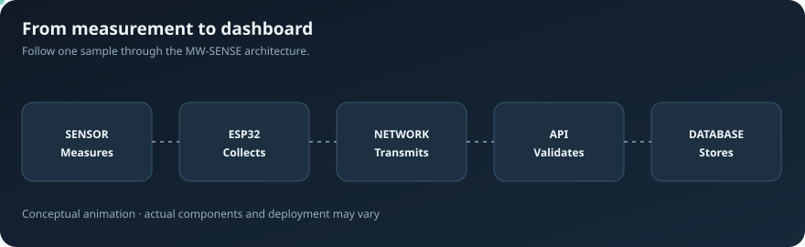
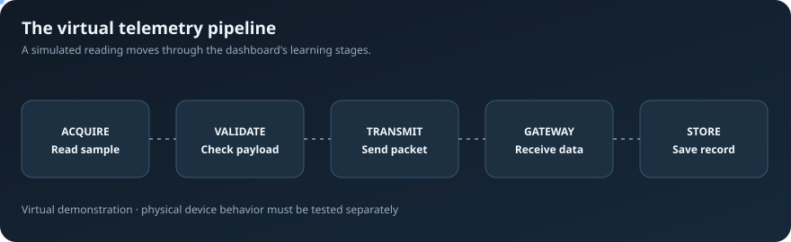
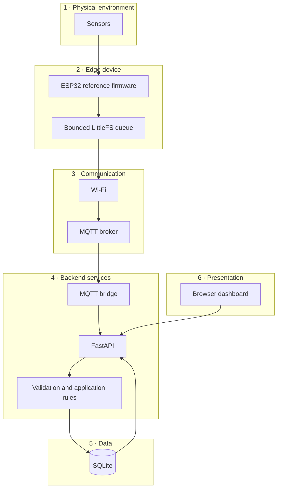
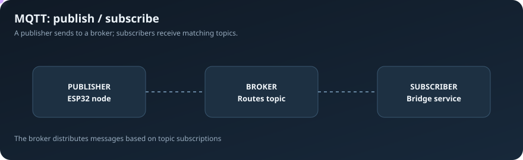
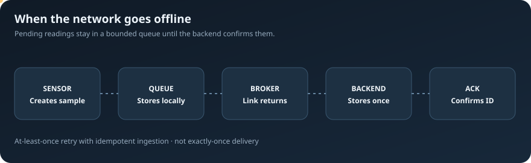
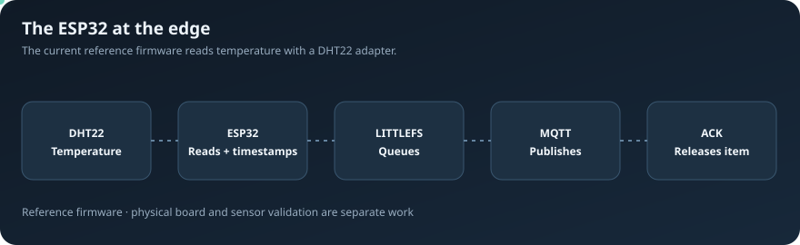
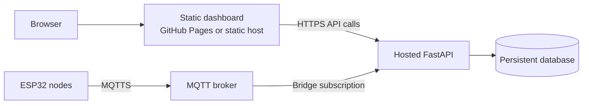

# MW-SENSE

<p align="center">
  <strong>Modular Wireless Sensor Network & Environmental Monitoring Platform</strong><br/>
  <em>Understand the journey from a physical measurement to useful information.</em>
</p>

<p align="center">
  <a href="https://github.com/chamanvashishth/MW-SENSE/actions/workflows/ci.yml"></a>
  <a href="LICENSE"></a>
  
  
</p>

MW-SENSE is an evolving Internet of Things (IoT) project for learning, building, and extending a wireless environmental monitoring system. It connects a browser-based virtual sensor lab, a telemetry API, a database, an MQTT bridge, and reference firmware for an ESP32 device.

The project is intentionally being developed in stages. The dashboard can be explored with simulated readings today; the repository also contains backend and firmware foundations for integrating real hardware. **A running demo is not the same as a field-tested deployment.** Hardware accuracy, radio coverage, power behavior, security configuration, and operational reliability must be verified on the actual installation.

> **In one sentence:** MW-SENSE demonstrates how an environmental reading can be created, checked, transmitted, stored, and made understandable to a person.

---

## Start here

| I want to… | Go to |
|---|---|
| Understand the project | [How it works](#how-it-works) |
| Run the virtual lab | [Run locally](#run-locally) |
| Understand MQTT and device communication | [Communication explained](#communication-explained) |
| Connect an ESP32 | [ESP32 reference firmware](firmware/esp32/README.md) |
| Explore API routes | [API reference](#api-reference) and `/docs` |
| Run tests | [Verification](#verification) |
| Understand deployment limitations | [Deployment and production readiness](#deployment-and-production-readiness) |
| Help improve the project | [Contributing](#contributing) |

---

## What problem does it explore?

Imagine monitoring a greenhouse. You want to know whether it is getting too hot, too humid, or too dry. Visiting every sensor to read a display is inconvenient. A connected monitoring system can collect readings at different locations and make them available in one place.

An IoT system is a combination of **physical devices, communication, and software**. MW-SENSE provides an educational foundation for exploring those pieces together.

Potential application areas include agriculture, indoor environments, laboratories, campuses, and infrastructure monitoring. These are use cases the architecture may support; they are not claims of validated deployments.

## How it works

The simplest way to understand MW-SENSE is to follow one reading through the system.

<p align="center">
  
</p>

**What the stages mean**

1. **Measure:** a sensor observes a physical condition such as temperature.
2. **Collect:** a microcontroller such as an ESP32 reads the sensor.
3. **Transmit:** the device sends a message over a network.
4. **Receive and validate:** software checks that the incoming data is well-formed and belongs to a known sensor.
5. **Store:** the backend saves accepted readings so they can be retrieved later.
6. **Visualize:** the dashboard turns the readings into values, tables, charts, and device information.

The diagram explains the intended end-to-end architecture. The browser virtual lab simulates this journey; it does not create real sensor measurements.

## Explore the virtual lab

The dashboard is also a small learning environment. It lets you adjust sample values, send simulated telemetry, inspect the processing stages, introduce network delay or packet loss, review records, and explore monitoring concepts.

<p align="center">
  
</p>

Current dashboard concepts include:

- Simulated temperature, humidity, air-quality, and soil-moisture values.
- A six-stage telemetry walkthrough.
- Adjustable simulated network latency and packet-loss probability.
- Normal, congested, unstable, and outage scenarios.
- Browser-local or API-backed record storage.
- Telemetry table and CSV export.
- Trend chart, configurable demonstration thresholds, and recent alerts.
- Virtual node registry.
- API-backed device registry, heartbeat information, and credential administration.

**Simulation is clearly bounded:** the air-quality value uses illustrative simulation units, not a calibrated ppm measurement. Dashboard node status in the virtual lab is not evidence that physical devices are online.

---

## Architecture at a glance

MW-SENSE is organized into layers so each part has a focused responsibility. A layer can be changed or extended without having to redesign the whole system, provided its interfaces remain compatible.



| Part | Technology in this repository | Plain-language responsibility |
|---|---|---|
| Dashboard | HTML, CSS, JavaScript | The screen a person interacts with. |
| Telemetry core | JavaScript | Shared rules for checking and handling virtual readings. |
| API | Python, FastAPI | The interface used by the dashboard and services to exchange data. |
| Database | SQLite | Stores validated readings and device information. |
| MQTT bridge | Python MQTT component | Connects broker messages to backend ingestion and acknowledgement logic. |
| Device firmware | ESP32, Arduino framework, PlatformIO | Reads a physical sensor and communicates with the broker. |
| Embedded queue | LittleFS | Keeps pending readings on device flash while delivery is unavailable. |
| Automated checks | Node.js, pytest, Playwright, PlatformIO, native C++ | Checks code and selected workflows automatically. |

### The important terms

- **IoT (Internet of Things):** physical devices that collect or act on information and communicate with software.
- **Telemetry:** measurements and status information sent by a device.
- **Edge device:** a small computer near the sensor that collects readings and may do some work locally.
- **ESP32:** a family of microcontrollers with built-in wireless connectivity.
- **MQTT:** a lightweight messaging protocol often used by connected devices.
- **Broker:** the MQTT service that receives messages from publishers and forwards them to subscribers.
- **API (Application Programming Interface):** a defined way for one program to request information or an operation from another.
- **Backend:** the server-side code that validates, processes, and stores information.
- **Database:** an organized place to keep information for later use.
- **LittleFS:** a filesystem designed for flash storage, used here for the ESP32's local queue.
- **Acknowledgement (ACK):** a reply that tells a sender that a particular operation was accepted.
- **Idempotency:** a property that makes repeating the same request safe from creating duplicate records.

---

## Communication explained

### MQTT: publisher, broker, subscriber

MQTT uses a publish/subscribe model. A publisher sends a message to a topic; a broker distributes that message to subscribers that have subscribed to a matching topic. A topic is a named message channel.

<p align="center">
  
</p>

The firmware reference uses topic patterns such as:

```text
mw-sense/{node_id}/{sensor_id}/telemetry
mw-sense/{node_id}/status
mw-sense/{node_id}/{sensor_id}/ack/{request_id}
```

The exact topic and payload contract is implemented in the firmware and MQTT bridge. See the [firmware guide](firmware/esp32/README.md) for the detailed message shape, provisioning, TLS, and acknowledgement behavior.

### What happens when connectivity is lost?

A device should not assume a wireless link is always available. The ESP32 reference stores readings in a bounded local queue before attempting transmission. When the link returns, it retries the oldest pending reading.

<p align="center">
  
</p>

The firmware uses a stable request ID when retrying a queued message. The backend uses that identifier for idempotent ingestion, and the bridge acknowledges accepted or already-recorded messages. The firmware removes a queue entry only when it receives a matching acknowledgement for the queue head.

**Delivery semantics matter:** the firmware telemetry publish uses MQTT QoS 0. The application-level acknowledgement is a separate mechanism. This is an at-least-once retry pattern with idempotent database ingestion—not an end-to-end exactly-once guarantee. See the reliability notes in the [firmware documentation](firmware/esp32/README.md) and the [deployment checklist](docs/DEPLOYMENT_CHECKLIST.md).

---

## Repository layout

```text
MW-SENSE/
├── index.html                  # Dashboard document and interface
├── styles.css                  # Dashboard layout and visual design
├── app.js                      # Dashboard interactions and application flow
├── telemetry-core.js           # Reusable virtual telemetry rules and adapters
├── package.json                # JavaScript project scripts
│
├── backend/
│   ├── main.py                 # FastAPI routes and application setup
│   ├── schemas.py               # Request and response validation models
│   ├── database.py              # SQLite persistence and device data
│   ├── backup.py                # Database backup helpers
│   ├── mqtt_bridge.py           # MQTT ingestion and acknowledgement bridge
│   ├── requirements.txt         # Runtime API dependencies
│   ├── requirements-dev.txt     # Backend test dependencies
│   ├── requirements-mqtt.txt    # MQTT bridge dependencies
│   └── tests/                   # API, backup, and MQTT bridge tests
│
├── firmware/
│   └── esp32/
│       ├── include/             # Firmware headers and example config
│       ├── src/                 # ESP32 application
│       ├── test/                # Embedded and native tests
│       ├── platformio.ini       # PlatformIO build configuration
│       └── README.md            # Hardware setup and protocol guide
│
├── tests/                       # JavaScript integration and browser tests
├── requirements-browser.txt    # Playwright Python dependency
├── docs/
│   ├── DEPLOYMENT_CHECKLIST.md  # Pilot and production-readiness gates
│   └── assets/animations/       # Explanatory animated SVG diagrams
└── .github/workflows/ci.yml    # Automated CI checks
```

---

## Run locally

The quickest way to explore the project is to run the dashboard and API separately. The repository's current `main` branch does not include a combined development launcher.

### Prerequisites

- Git
- Python 3.12 (the CI-tested Python version)
- Node.js 22 or a compatible current Node.js release
- A modern browser

### 1. Clone the repository

```bash
git clone https://github.com/chamanvashishth/MW-SENSE.git
cd MW-SENSE
```

### 2. Create a Python virtual environment

**Windows PowerShell**

```powershell
py -3.12 -m venv .venv
.\.venv\Scripts\Activate.ps1
```

If PowerShell blocks activation in the current terminal:

```powershell
Set-ExecutionPolicy -Scope Process -ExecutionPolicy Bypass
.\.venv\Scripts\Activate.ps1
```

**Linux / macOS**

```bash
python3.12 -m venv .venv
source .venv/bin/activate
```

### 3. Install backend dependencies

```bash
python -m pip install --upgrade pip
python -m pip install -r backend/requirements-dev.txt
```

### 4. Start the API

From the repository root:

```bash
python -m uvicorn backend.main:app --reload --host 127.0.0.1 --port 8001
```

The API will be available at:

| Resource | Address |
|---|---|
| Health check | http://127.0.0.1:8001/health |
| Interactive API docs | http://127.0.0.1:8001/docs |
| OpenAPI schema | http://127.0.0.1:8001/openapi.json |

### 5. Start the dashboard

Open a second terminal in the repository root and run:

```bash
python -m http.server 8000 --bind 127.0.0.1
```

Then open:

```text
http://127.0.0.1:8000
```

To stop either server, press `Ctrl + C` in its terminal.

### 6. Connect the dashboard to the API

In the dashboard's data explorer:

1. Change **Storage** to **API server**.
2. Keep or enter `http://127.0.0.1:8001`.
3. Enter the API token if authentication is enabled.
4. Select **Connect**.

For an initial exploration, the browser-local mode can be used without the API process. It stores virtual-lab records in that browser only.

---

## Configuration

The backend reads configuration from environment variables. Keep secrets out of source control.

| Variable | Purpose | Default / behavior |
|---|---|---|
| `MW_SENSE_API_TOKEN` | Optional bearer token required by protected API routes when set. | Unset means the API's token dependency does not enforce a token. |
| `MW_SENSE_DB_PATH` | SQLite database file location. | Backend's default database path. |
| `MW_SENSE_ALLOWED_ORIGINS` | Comma-separated browser origins permitted by CORS. | `http://localhost:8000,http://127.0.0.1:8000` |
| `MW_SENSE_RETENTION_DAYS` | Retain telemetry for this many days; zero disables time-based pruning. | `0` |
| `MW_SENSE_DEVICE_OFFLINE_SECONDS` | Heartbeat age after which a node is treated as offline during device listing. | `120` |
| `MW_SENSE_QUEUE_WARNING_DEPTH` | Queue-depth warning threshold for device health. | `10` |
| `MW_SENSE_RETRY_WARNING_COUNT` | Retry-count warning threshold. | `5` |
| `MW_SENSE_WEAK_WIFI_RSSI_DBM` | Absolute RSSI threshold used for weak-signal warnings. | `85` |
| `MW_SENSE_PENDING_WARNING_SECONDS` | Oldest pending sample age warning threshold. | `900` |

Example for a local PowerShell session:

```powershell
$env:MW_SENSE_API_TOKEN = "replace-with-a-local-development-token"
$env:MW_SENSE_DB_PATH = "$PWD\data\mw_sense.db"
$env:MW_SENSE_ALLOWED_ORIGINS = "http://127.0.0.1:8000"
python -m uvicorn backend.main:app --reload --host 127.0.0.1 --port 8001
```

Example for Linux / macOS:

```bash
export MW_SENSE_API_TOKEN="replace-with-a-local-development-token"
export MW_SENSE_DB_PATH="$PWD/data/mw_sense.db"
export MW_SENSE_ALLOWED_ORIGINS="http://127.0.0.1:8000"
python -m uvicorn backend.main:app --reload --host 127.0.0.1 --port 8001
```

The API's `/health` endpoint is intentionally simple. Protected diagnostics are available at `/health/diagnostics` when configured. Never publish development credentials or expose the development server directly to the public internet.

---

## API reference

FastAPI generates interactive documentation from the running application. Open [`/docs`](http://127.0.0.1:8001/docs) while the local API is running to inspect schemas and try requests.

The current route surface includes:

| Method | Route | Purpose |
|---|---|---|
| `GET` | `/health` | Basic service health response. |
| `GET` | `/health/diagnostics` | Protected database and retention diagnostics. |
| `GET` | `/sensors` | Protected configured sensor catalogue. |
| `POST` | `/devices` | Register a supported device node. |
| `GET` | `/devices` | List nodes and derived health information. |
| `POST` | `/devices/{node_id}/heartbeat` | Record device status and runtime information. |
| `POST` | `/devices/{node_id}/credentials` | Issue or rotate a device credential. |
| `DELETE` | `/devices/{node_id}/credentials` | Revoke a device credential. |
| `GET` | `/devices/{node_id}/credential-events` | Read protected credential history. |
| `GET` | `/devices/{node_id}/lifecycle-events` | Read protected lifecycle history. |
| `GET` | `/telemetry` | Retrieve validated readings with filtering and pagination. |
| `POST` | `/telemetry` | Validate and store one telemetry reading. |
| `DELETE` | `/telemetry` | Clear stored readings. |

Protected routes require a bearer token when `MW_SENSE_API_TOKEN` is configured. The exact request and response models are defined in [`backend/schemas.py`](backend/schemas.py).

### Telemetry validation

The current API catalogue defines these parameter assignments:

| Parameter | Node | Sensor | Unit | Accepted range |
|---|---|---|---|---|
| Temperature | `NODE-01` | `TEMP-01` | °C | 0–50 |
| Humidity | `NODE-01` | `HUM-01` | % | 0–100 |
| Air quality | `NODE-02` | `AIR-02` | simulated units | 0–500 |
| Soil moisture | `NODE-03` | `SOIL-01` | % | 0–100 |

These are the current software validation rules, not a statement that the firmware measures every listed parameter. The reference ESP32 firmware currently implements the temperature adapter.

A telemetry payload includes a node ID, sensor ID, parameter, timestamp, value, unit, and a `simulation` flag. Optional request and firmware identifiers are also supported. Timestamps are validated as ISO 8601 date-time strings.

---

## ESP32 reference firmware

The repository includes a PlatformIO reference firmware project for an ESP32 development board. It currently uses an example DHT22 temperature adapter; other sensor drivers are not yet implemented in this firmware reference.

<p align="center">
  
</p>

The firmware currently demonstrates:

- Wi-Fi and MQTT reconnection attempts.
- DHT22 temperature reading.
- Waiting for NTP time synchronization before timestamping a reading.
- MQTT telemetry and heartbeat publishing.
- A bounded LittleFS queue for pending samples.
- Stable request IDs across retries.
- Application-level acknowledgement matching.
- Per-device credential support.
- TLS certificate verification by default.
- Runtime reporting such as uptime, queue depth, retry count, Wi-Fi RSSI, MQTT state, and boot count.

### Build the firmware

Install PlatformIO, then prepare a private configuration file:

**Windows PowerShell**

```powershell
Copy-Item firmware/esp32/include/config.h.example firmware/esp32/include/config.h
```

**Linux / macOS**

```bash
cp firmware/esp32/include/config.h.example firmware/esp32/include/config.h
```

Edit `firmware/esp32/include/config.h` with your board's Wi-Fi settings, MQTT broker address, broker credentials, CA certificate, node ID, and provisioned device credential.

The real `config.h` is ignored by Git. Do not commit Wi-Fi passwords, broker credentials, device tokens, private keys, or other secrets.

Build from the repository root:

```bash
pio run -d firmware/esp32
```

For wiring, broker setup, device registration, credential provisioning, TLS configuration, telemetry topics, and failure behavior, read the dedicated [ESP32 firmware guide](firmware/esp32/README.md).

**Build success is not a hardware test.** It does not prove sensor calibration, Wi-Fi coverage, broker access, electrical safety, or field reliability.

---

## Verification

The repository's CI workflow checks multiple parts of the system. You can run the corresponding checks locally.

### JavaScript syntax

```bash
node --check app.js
node --check telemetry-core.js
```

### JavaScript tests

```bash
npm test
```

### Backend tests

Activate the Python virtual environment, then run:

```bash
python -m pip install -r backend/requirements-dev.txt
python -m pytest backend/tests -q
```

### Browser smoke tests

Install the browser test requirements:

```bash
python -m pip install -r requirements-browser.txt -r backend/requirements.txt
python -m playwright install chromium
```

Run the browser smoke workflow:

```bash
python tests/browser_smoke.py
```

### ESP32 firmware compile

Create the example configuration as described above, then:

```bash
pio run -d firmware/esp32
```

### Native offline-queue tests

With a C++17 compiler available, prepare the example firmware configuration and run:

```bash
g++ -std=c++17 -Wall -Wextra -Werror \
  -Ifirmware/esp32/test/native/stubs \
  -Ifirmware/esp32/include \
  firmware/esp32/test/native/test_offline_queue.cpp \
  -o mw-sense-offline-queue-tests
./mw-sense-offline-queue-tests
```

The commands above mirror the checks configured in [`.github/workflows/ci.yml`](.github/workflows/ci.yml). A green CI run is evidence that those automated checks passed for that commit; it is not evidence of a tested physical installation.

---

## Deployment and production readiness

### GitHub Pages: dashboard and documentation only

GitHub Pages can publish static files such as HTML, CSS, JavaScript, Markdown-rendered project pages, and SVG assets. It **cannot run** the FastAPI Python server, SQLite database process, or MQTT broker.

A future hosted deployment would therefore need separate services:



Before connecting a public dashboard to a hosted API:

- Set a production API base URL; do not leave `127.0.0.1` as the public endpoint.
- Configure an explicit CORS allowlist for the deployed dashboard origin.
- Use HTTPS for the API and verified TLS for MQTT.
- Keep administrator tokens and device credentials out of frontend JavaScript.
- Use a persistent database volume and tested backups.
- Restrict broker topic permissions and issue unique credentials to devices.
- Review the [deployment checklist](docs/DEPLOYMENT_CHECKLIST.md).

### What production-ready means here

The project is not described as production-ready simply because it builds or runs locally. Before a real pilot, the deployment checklist calls for evidence around secure configuration, database recovery, broker permissions, real sensor calibration, interruption testing, duplicate handling, device health, and operational ownership.

Important known boundaries include:

- The reference firmware currently publishes telemetry at MQTT QoS 0 and uses an application-level acknowledgement after backend ingestion.
- The queue retry strategy is designed for at-least-once delivery with idempotent database ingestion, not an exactly-once guarantee.
- Firmware compile and native queue tests do not emulate real flash wear, brownouts, radio conditions, sensor error, or field power behavior.
- Device offline transitions are derived when the device registry is polled; they are not guaranteed instant event notifications.
- The current ESP32 sensor adapter reads temperature. Other dashboard parameters are virtual/software demonstrations until corresponding hardware drivers and tests exist.

Treat [`docs/DEPLOYMENT_CHECKLIST.md`](docs/DEPLOYMENT_CHECKLIST.md) as a verification gate for any controlled pilot, not a marketing statement.

---

## Roadmap

MW-SENSE is expected to gain more sensors, capabilities, deployment options, and operational tooling over time. The roadmap is directional; an unchecked item is planned work, not an implemented feature.

### Hardware and connectivity
- [ ] Add and validate additional physical sensor adapters.
- [ ] Verify device behavior across Wi-Fi and broker outages.
- [ ] Perform target-board queue and power-interruption testing.
- [ ] Document supported boards, wiring, power, and calibration.

### Device operations
- [ ] Improve device provisioning and fleet workflows.
- [ ] Define a versioned device capability model.
- [ ] Add safe configuration updates and firmware update strategy.
- [ ] Expand device diagnostics and operator workflows.

### Data and intelligence
- [ ] Expand historical data exploration.
- [ ] Introduce configurable alert policies with clear ownership.
- [ ] Evaluate anomaly detection and forecasting using validated datasets.
- [ ] Add export and integration options for external systems.

### Deployment and operations
- [ ] Add documented deployment profiles.
- [ ] Improve structured logging and service observability.
- [ ] Strengthen backup, restore, and upgrade procedures.
- [ ] Measure performance and reliability under representative workloads.
- [ ] Review security boundaries as new services are introduced.

New technology should be introduced to solve a demonstrated need, not simply to make the stack larger. Prefer stable interfaces, explicit configuration, documented migrations, automated tests, and backward-compatible changes where practical.

---

## Contributing

Contributions are welcome across the dashboard, telemetry logic, API, MQTT bridge, firmware, tests, and documentation.

A useful change should explain the problem it solves and include the level of verification appropriate to that change.

1. Fork the repository.
2. Create a focused branch.
3. Make the change and add or update tests.
4. Run the relevant local checks.
5. Update documentation when behavior or configuration changes.
6. Open a pull request with a concise explanation and test evidence.

Example:

```bash
git checkout -b feat/describe-your-change
git add .
git commit -m "feat: describe the change"
git push -u origin feat/describe-your-change
```

For hardware-related changes, include board details, sensor model, wiring, firmware version, and whether the result was compiled, simulated, or tested on physical hardware. Do not report a simulation as a hardware test.

### Pull request checklist

- [ ] The change has a clear scope.
- [ ] Existing behavior and interfaces were reviewed.
- [ ] Relevant tests were added or updated.
- [ ] Relevant checks pass locally.
- [ ] Configuration and secrets are handled safely.
- [ ] Documentation and diagrams match the implementation.
- [ ] Hardware validation status is stated honestly.

---

## Documentation map

- [ESP32 firmware guide](firmware/esp32/README.md) — build, provisioning, MQTT topics, TLS, queue, acknowledgements, and limitations.
- [Deployment checklist](docs/DEPLOYMENT_CHECKLIST.md) — security, database recovery, broker, hardware, dashboard, and pilot verification.
- [API source](backend/main.py) — implemented API routes.
- [Validation models](backend/schemas.py) — telemetry and device request/response schemas.
- [CI workflow](.github/workflows/ci.yml) — automated checks run for pushes and pull requests.

## License

This project is distributed under the terms in [LICENSE](LICENSE).

---

<p align="center">
  <strong>MW-SENSE</strong><br/>
  <em>Build the path from sensor data to understanding.</em>
</p>
