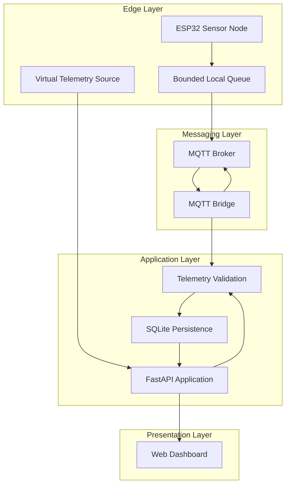

# MW-SENSE

### Modular Wireless Sensor Network & Telemetry Platform

**MW-SENSE** is an IoT telemetry platform for collecting, transporting, validating, storing, and visualizing sensor data from distributed edge devices.

The system combines an ESP32-based device layer, MQTT messaging, a FastAPI backend, SQLite persistence, and a browser-based monitoring dashboard. It also provides a virtual telemetry path for development and demonstration without requiring physical hardware.

The project is structured around a clear separation of responsibilities: devices produce telemetry, the messaging layer transports it, the backend validates and persists it, and the dashboard presents the resulting system state.

---

## 1. System Overview

MW-SENSE addresses the practical engineering challenges involved in building a small distributed sensor-monitoring system:

- **Device communication:** Transport telemetry from edge devices through MQTT.
- **Data ingestion:** Validate incoming messages before accepting them into the application.
- **Persistence:** Store telemetry and device information using SQLite.
- **Delivery reliability:** Use request identifiers, application-level acknowledgements, and database uniqueness constraints to support safe redelivery.
- **Operational visibility:** Expose device status, telemetry history, and monitoring information through an API and browser dashboard.
- **Development without hardware:** Support virtual telemetry so that application workflows can be exercised independently of physical sensors.

### Project status

| Area | Implementation |
|---|---|
| Backend API | FastAPI |
| Data persistence | SQLite |
| Messaging | MQTT integration |
| Edge hardware | ESP32 reference firmware |
| Dashboard | Browser-based interface |
| Virtual telemetry | Supported |
| Device status monitoring | Supported |
| Telemetry validation | Implemented |
| Application-level acknowledgements | Implemented |
| Hardware-independent development | Supported |

> **Engineering note:** MW-SENSE is an actively developed reference implementation. Its current capabilities should not be interpreted as production certification, industrial-grade hardware validation, or a guarantee of exactly-once message delivery.

---

## 2. Architecture

MW-SENSE follows a layered architecture. Each component has a defined responsibility and communicates through explicit interfaces.



### Component responsibilities

| Component | Responsibility |
|---|---|
| ESP32 firmware | Collect sensor readings and publish device telemetry |
| Local device queue | Temporarily retain pending messages within bounded storage |
| MQTT broker | Transport messages between devices and backend services |
| MQTT bridge | Subscribe to device topics, validate physical telemetry, and publish acknowledgements |
| FastAPI | Expose application interfaces and coordinate backend operations |
| Validation layer | Enforce telemetry and device-level constraints |
| SQLite | Persist application and telemetry records |
| Virtual telemetry | Exercise application workflows without physical devices |
| Dashboard | Present device and telemetry information to users |

The architecture intentionally keeps the device transport layer separate from the application-facing API. This makes it possible to develop and test backend functionality without requiring an active sensor network.

---

## 3. Data Flow

MW-SENSE supports two primary telemetry paths.

### 3.1 Physical telemetry

The physical telemetry path begins at an ESP32-based sensor node.

1. The device collects a sensor measurement.
2. Firmware constructs a telemetry message containing the device identity, sensor identity, request identifier, and measurement data.
3. The message is published to the configured MQTT topic.
4. The MQTT bridge receives the message.
5. The bridge validates the device credentials and message requirements.
6. Accepted telemetry is passed into the backend ingestion workflow.
7. The application persists the accepted record.
8. An application-level acknowledgement is published for the corresponding request identifier.
9. The device can use the acknowledgement to determine whether the message was accepted.

Physical telemetry is distinguished from simulated telemetry. The MQTT bridge only accepts messages explicitly identified as physical telemetry.

### 3.2 Virtual telemetry

The virtual telemetry path allows the platform to operate without ESP32 hardware or a physical MQTT deployment.

Virtual telemetry enters through the application layer and follows the relevant validation and persistence workflow.

This is useful for:

- Dashboard development.
- Backend integration testing.
- Demonstrations.
- Development without hardware.
- Reproducing application-level telemetry scenarios.

Virtual data should not be interpreted as a measurement from a calibrated physical sensor.

---

## 4. Delivery and Reliability Model

Reliable telemetry delivery requires more than publishing messages to a broker. MW-SENSE uses multiple mechanisms to reduce the impact of interrupted connections and repeated message delivery.

### MQTT delivery

The MQTT bridge subscribes to device telemetry and status topics using QoS 1.

The reference firmware publishes telemetry using QoS 0. Consequently, broker-level delivery guarantees differ between the firmware publishing path and the backend subscription path.

### Application-level acknowledgement

MW-SENSE uses application acknowledgements in addition to MQTT delivery semantics.

Each telemetry request must contain a stable request identifier. After the backend processes an accepted message, the bridge publishes an acknowledgement associated with that identifier.

### Duplicate protection

Database uniqueness constraints and stable request identifiers help prevent repeated delivery from creating duplicate telemetry records.

### Delivery guarantee

The system is designed around retryable, at-least-once application delivery where the device and transport implementation support retries.

It does **not** claim exactly-once delivery across the complete device-to-database pipeline.

This distinction is important: MQTT QoS, application acknowledgements, and database idempotency solve different parts of the delivery problem.

---

## 5. Repository Structure

The repository is organized by system responsibility.

```text
MW-SENSE/
├── backend/
│   ├── tests/
│   ├── mqtt_bridge.py
│   └── requirements.txt
├── firmware/
│   └── ESP32 reference implementation
├── scripts/
├── dashboard/
├── package.json
├── README.md
└── ...
```

The tree above describes the principal architectural areas. Refer to the repository for the current complete file and directory inventory.

| Area | Purpose |
|---|---|
| `backend/` | API, ingestion, persistence, and messaging integration |
| `backend/tests/` | Backend regression and integration-oriented tests |
| `backend/mqtt_bridge.py` | MQTT subscription, device validation, and acknowledgement handling |
| `firmware/` | Embedded reference implementation |
| `scripts/` | Development and supporting utilities |
| `dashboard/` | Browser-facing monitoring interface |
| `package.json` | JavaScript development and verification commands |

---

## 6. Technology Stack

| Layer | Technology |
|---|---|
| Embedded platform | ESP32 |
| Firmware framework | PlatformIO |
| Messaging protocol | MQTT |
| Backend framework | FastAPI |
| Backend runtime | Python |
| API server | Uvicorn |
| Database | SQLite |
| Frontend | JavaScript |
| Development runtime | Node.js |
| Testing | Pytest and JavaScript test tooling |

### Requirements

The development environment uses:

- Python 3.12
- Node.js 22
- npm
- Git
- PlatformIO, for firmware development
- An MQTT broker, for physical device integration

Physical hardware and a running MQTT broker are not required for all development workflows. The virtual telemetry path supports hardware-independent application development.

---

## 7. Local Development

The backend and browser dashboard are separate development processes. They should be configured and started independently.

### 7.1 Clone the repository

```bash
git clone https://github.com/chamanvashishth/MW-SENSE.git
cd MW-SENSE
```

### 7.2 Backend environment

Create and activate a Python virtual environment.

**Windows PowerShell**

```powershell
python -m venv .venv
.venv\Scripts\Activate.ps1
```

**Linux / macOS**

```bash
python3 -m venv .venv
source .venv/bin/activate
```

Install backend dependencies:

```bash
pip install -r backend/requirements.txt
```

Start the FastAPI application using the application's current ASGI entry point and the configuration described in the backend source.

The API and MQTT bridge are separate concerns. The MQTT bridge additionally requires a reachable broker and its corresponding device and broker configuration.

### 7.3 Dashboard environment

Install JavaScript dependencies:

```bash
npm install
```

Run the dashboard using the development script defined in `package.json`.

The API and dashboard must be configured to communicate through the intended API origin.

> MW-SENSE does not assume that a single command launches the complete system. Backend, dashboard, and optional MQTT infrastructure have independent runtime requirements.

---

## 8. Configuration

The backend supports environment-based configuration.

| Variable | Purpose |
|---|---|
| `MW_SENSE_API_TOKEN` | Enables API token authentication when configured |
| `MW_SENSE_DB_PATH` | Configures the SQLite database location |
| `MW_SENSE_ALLOWED_ORIGINS` | Configures permitted browser origins |
| `MW_SENSE_RETENTION_DAYS` | Configures telemetry retention |
| `MW_SENSE_DEVICE_OFFLINE_SECONDS` | Sets the device offline threshold |
| `MW_SENSE_QUEUE_WARNING_DEPTH` | Configures the queue-depth warning threshold |
| `MW_SENSE_RETRY_WARNING_COUNT` | Configures the retry warning threshold |
| `MW_SENSE_WEAK_WIFI_RSSI_DBM` | Sets the weak Wi-Fi signal threshold |
| `MW_SENSE_PENDING_WARNING_SECONDS` | Configures the pending-message warning threshold |

### Example

```env
MW_SENSE_API_TOKEN=replace-with-a-secure-token
MW_SENSE_DB_PATH=./data/mw-sense.db
MW_SENSE_ALLOWED_ORIGINS=http://localhost:3000
MW_SENSE_RETENTION_DAYS=30
MW_SENSE_DEVICE_OFFLINE_SECONDS=120
MW_SENSE_QUEUE_WARNING_DEPTH=20
MW_SENSE_RETRY_WARNING_COUNT=5
MW_SENSE_WEAK_WIFI_RSSI_DBM=-75
MW_SENSE_PENDING_WARNING_SECONDS=60
```

The values above are illustrative development settings, not universal production recommendations.

Do not commit credentials, access tokens, private broker configuration, or deployment secrets to version control.

---

## 9. MQTT Integration

The MQTT bridge connects physical device telemetry to the application ingestion workflow.

### Topic conventions

| Topic | Direction | Purpose |
|---|---|---|
| `mw-sense/{node_id}/{sensor_id}/telemetry` | Device → backend | Sensor telemetry |
| `mw-sense/{node_id}/status` | Device → backend | Device status and heartbeat |
| `mw-sense/{node_id}/{sensor_id}/ack/{request_id}` | Backend → device | Application acknowledgement |

The bridge subscribes to telemetry and status topics using QoS 1 and publishes application acknowledgements using QoS 1.

### Broker configuration

The bridge requires an MQTT host configuration.

| Setting | Configuration |
|---|---|
| Host | `MW_SENSE_MQTT_HOST` |
| Port | `MW_SENSE_MQTT_PORT` |
| TLS | `MW_SENSE_MQTT_TLS` |

The default port is `8883`, and TLS is enabled by default.

The bridge also enforces a bounded JSON payload size of 4096 bytes.

### Message requirements

Physical telemetry messages must satisfy the bridge's device validation requirements and include a stable request identifier.

The bridge rejects messages that do not meet the physical telemetry requirements.

For deployment, use unique device credentials, broker-side topic ACLs, TLS certificate validation, and appropriately restricted network access.

---

## 10. ESP32 Firmware

The firmware directory contains the ESP32 reference implementation used to demonstrate the physical telemetry path.

Its responsibilities include:

- Connecting to the configured network.
- Collecting supported sensor readings.
- Constructing telemetry messages.
- Publishing messages to the MQTT broker.
- Maintaining bounded local pending-message storage.
- Processing application acknowledgements.

### Hardware boundary

The reference implementation should not be confused with a complete hardware abstraction framework.

The current ESP32 reference firmware supports a temperature sensor adapter. Additional sensor types require corresponding firmware adapters and validation of their telemetry contracts.

### Firmware build

Install PlatformIO and use the project's firmware configuration.

```bash
pio run
```

Firmware compilation and hardware-in-the-loop validation are separate verification activities. A successful firmware build does not establish that a physical deployment is correctly calibrated or operational.

---

## 11. API and Data Contracts

FastAPI provides the application-facing interface for device and telemetry operations.

The backend is responsible for:

- Accepting application requests.
- Validating device and telemetry data.
- Persisting accepted records.
- Exposing device and telemetry information.
- Supporting the dashboard's application workflows.

The MQTT bridge provides a separate integration boundary for physical device messages.

### Telemetry contract

Telemetry records are associated with a device, a sensor, and a request identifier.

The ingestion workflow distinguishes physical telemetry from simulated telemetry. This distinction is essential for monitoring, testing, and interpreting measurements correctly.

The authoritative API routes, request models, response schemas, and validation rules are maintained in the backend implementation. They should be treated as the source of truth when integrating another client.

---

## 12. Verification

MW-SENSE uses independent verification workflows for its backend, dashboard, and embedded firmware.

Run checks from the repository root unless otherwise specified.

### JavaScript checks

```bash
npm run check
```

### JavaScript tests

```bash
npm test
```

### Backend tests

```bash
python -m pytest backend/tests -q
```

### Firmware build

```bash
pio run
```

### Additional verification

The repository also contains verification coverage for native offline-queue behavior and browser-facing functionality.

The checks are intentionally separated because a passing test suite for one component does not establish correctness across the complete device-to-dashboard pipeline.

### Verification scope

| Verification | What it establishes |
|---|---|
| JavaScript checks | Static or syntax-level frontend validation |
| JavaScript tests | Tested dashboard and application behavior |
| Pytest | Tested backend behavior |
| PlatformIO build | Firmware compilation |
| Offline queue tests | Tested local queue behavior |
| Browser smoke checks | Tested browser workflows in the available environment |

Report actual command output and environment details when publishing test results. Do not treat an unexecuted check as a passing check.

---

## 13. Security and Operational Considerations

Security and reliability are system-level properties. They cannot be established by the API or firmware in isolation.

### Authentication

API token authentication is enabled when `MW_SENSE_API_TOKEN` is configured.

If the variable is unset, token-based authentication is disabled. Deployments that expose the API beyond a trusted local development environment should configure authentication deliberately.

### MQTT security

Production MQTT deployments should use:

- TLS-protected broker connections.
- Unique credentials for each device.
- Broker-side topic access control.
- Restricted network exposure.
- Credential rotation and revocation procedures.

### Browser access

Configure allowed origins deliberately. CORS is a browser access policy, not an authentication or authorization mechanism.

### Persistence

SQLite is appropriate for the current application scope. Production deployments should define:

- Backup and recovery procedures.
- Retention policies.
- Database integrity checks.
- Storage monitoring.
- Migration procedures before schema changes.

### Device availability

Device offline state is derived when the device list is requested, using the configured offline threshold. It should not be interpreted as an independently generated real-time push notification.

### Measurement integrity

Virtual telemetry is useful for software validation, but it is not evidence of physical sensor accuracy. Real-world measurements require hardware testing, calibration, and environmental validation.

---

## 14. Engineering Boundaries and Known Limitations

The following distinctions are important when extending the platform:

1. **MQTT QoS is not end-to-end exactly-once delivery.** Application-level acknowledgement and idempotent persistence address additional failure modes but do not create a universal exactly-once guarantee.
2. **Virtual telemetry is not physical telemetry.** Simulated measurements must remain distinguishable from actual device readings.
3. **Reference firmware is not a universal sensor driver framework.** Additional hardware requires explicit implementation and validation.
4. **A successful API test is not an end-to-end deployment test.** MQTT, device connectivity, storage, and browser behavior require their own verification.
5. **Development defaults are not production security settings.** Authentication, TLS, credentials, network access, and backup procedures must be configured for the deployment environment.

These boundaries are documented intentionally so that contributors can distinguish implemented behavior from future engineering work.

---

## 15. Development Principles

Contributions to MW-SENSE should preserve the architectural separation between:

- Device acquisition and application ingestion.
- MQTT transport and business validation.
- Physical and simulated telemetry.
- Persistence and presentation.
- Development convenience and production guarantees.

When extending the system:

- Prefer explicit contracts over implicit assumptions.
- Keep telemetry validation close to the ingestion boundary.
- Preserve stable request identifiers across retries.
- Make state transitions observable and testable.
- Keep device-specific behavior out of the general application layer.
- Add regression tests for changes to message formats or persistence semantics.
- Document operational requirements alongside new integration points.

---

## 16. Contributing

Contributions are welcome.

Before proposing a change:

1. Understand the affected system boundary.
2. Review existing implementation and tests.
3. Keep changes scoped to a clearly defined responsibility.
4. Add or update regression coverage.
5. Run the relevant verification commands.
6. Document configuration or contract changes.

For substantial changes, include the motivation, architectural impact, testing performed, and any operational trade-offs.

---

## 17. License

Refer to the repository's `LICENSE` file for the applicable licensing terms.

---

## Project

**MW-SENSE — Modular Wireless Sensor Network & Telemetry Platform**

Repository: https://github.com/chamanvashishth/MW-SENSE

Built around practical IoT engineering: reliable telemetry ingestion, explicit system boundaries, and observable device communication.
