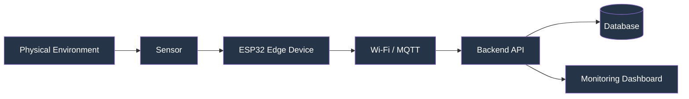
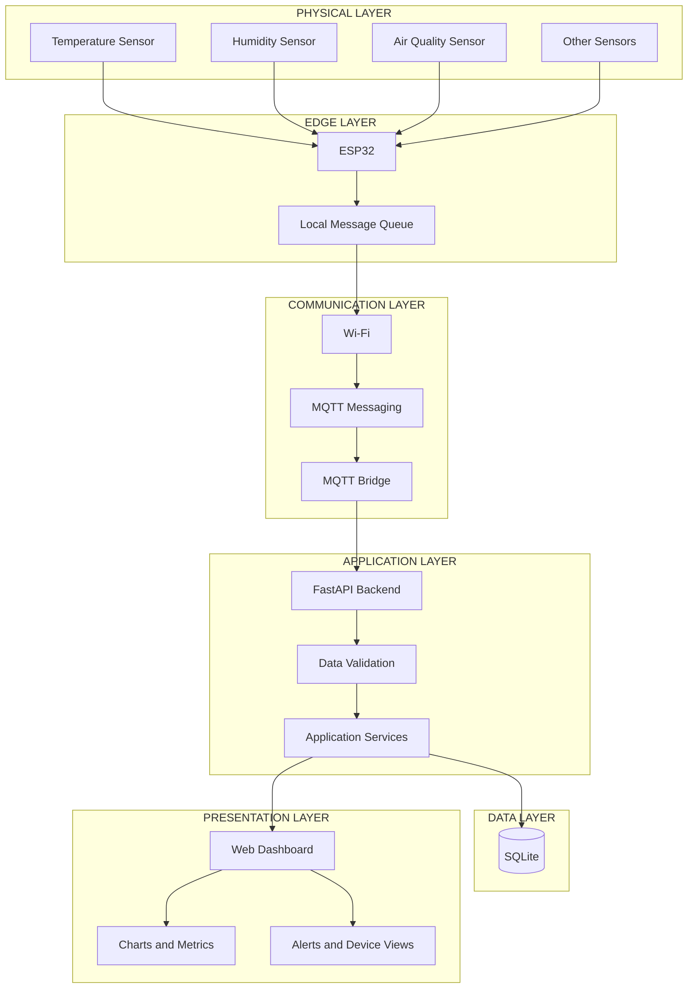
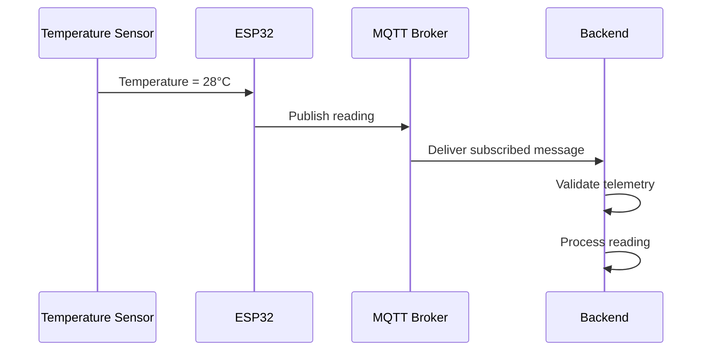
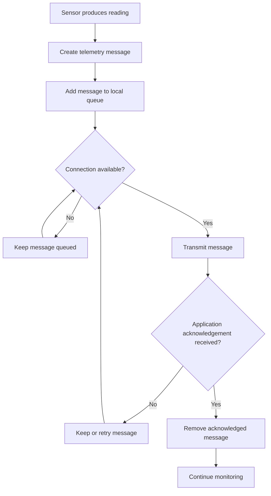
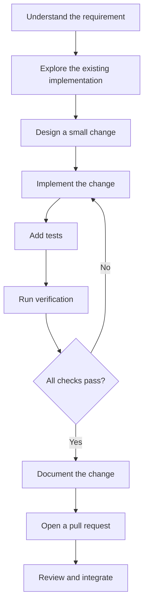

# MW-SENSE

### Modular Wireless Sensor Network & Environmental Intelligence Platform

**Connecting the physical world to meaningful data.**

MW-SENSE is an evolving Internet of Things (IoT) platform designed to collect, transmit, process, store, and visualize environmental sensor data through a modular wireless sensor network.

It brings together edge devices, wireless communication, backend services, data storage, and an interactive monitoring dashboard into one extensible system.

The goal is to create a platform that can begin with simulated sensor data, grow into real hardware integration, and progressively support more advanced monitoring, automation, analytics, and intelligent capabilities.

> **Project philosophy:** Build modularly. Explain clearly. Validate continuously. Expand responsibly.

---

## 01. What is MW-SENSE?

Imagine a temperature sensor placed inside a greenhouse.

The sensor measures the temperature. A small device collects the measurement and sends it wirelessly to a computer. Software receives the information, stores it, and displays it on a dashboard.

You can then monitor the temperature without physically visiting the sensor.

That is the fundamental idea behind MW-SENSE.

It aims to provide the software infrastructure needed to build, operate, and extend this kind of connected monitoring system.

### What can it eventually support?

- Environmental monitoring.
- Temperature and humidity tracking.
- Air-quality monitoring.
- Soil-moisture monitoring.
- Distributed wireless sensor networks.
- Remote device monitoring.
- Historical data analysis.
- Configurable alerts.
- Intelligent environmental insights.
- Future automation and edge-computing capabilities.

These represent the project's direction. Actual support depends on the implementation and validation of each feature.

---

## 02. See How MW-SENSE Works

Understanding the complete system is easier when we follow one measurement.

### The complete data journey

<!-- Replace the following image path when the explanatory animation is committed. -->
<p align="center">
  
</p>

*Animation concept: a sensor measures the environment, an ESP32 collects the reading, wireless communication transports it, the backend processes it, and the dashboard presents the result.*



### Step-by-step explanation

| Step | What happens | In simple words |
|---|---|---|
| 1. Sensing | A sensor measures its environment. | A device observes something. |
| 2. Collection | An ESP32 collects the measurement. | A small computer reads the sensor. |
| 3. Communication | Data travels over Wi-Fi or MQTT. | The reading is sent wirelessly. |
| 4. Processing | The backend receives and validates it. | Software checks the incoming information. |
| 5. Storage | The reading is saved in a database. | Information is remembered. |
| 6. Visualization | The dashboard displays the reading. | A person can understand the result. |

This separation makes the platform easier to test, maintain, and extend.

---

## 03. Understanding the Architecture

MW-SENSE follows a modular architecture. Each part has a defined responsibility and communicates with other parts through explicit interfaces.

### High-level architecture



### The six major layers

**1. Physical layer — where information originates**

This layer contains sensors that measure real-world conditions.

Examples:
- Temperature sensors.
- Humidity sensors.
- Soil-moisture sensors.
- Air-quality sensors.

A sensor converts a physical condition into a value that an electronic system can read.

**2. Edge layer — where devices collect information**

The edge layer contains devices such as the ESP32.

An ESP32 is a programmable microcontroller with wireless connectivity. It can read sensors, perform basic processing, and communicate with other systems.

**3. Communication layer — how information travels**

This layer handles the transfer of data between devices and software.

MW-SENSE includes an MQTT-oriented communication foundation.

MQTT is a lightweight messaging protocol commonly used in IoT because it is designed for communication between connected devices.

**4. Application layer — where information is processed**

The backend receives incoming information, checks its structure, applies application rules, and exposes functionality through an API.

An API is simply a defined way for two software systems to communicate.

**5. Data layer — where information is stored**

The database stores application data so that it can be retrieved later.

The current backend uses SQLite, a lightweight database that stores information in a local file.

**6. Presentation layer — where information becomes understandable**

The web dashboard turns measurements into useful information through metrics, charts, device views, and alerts.

---

## 04. How Devices Communicate

### Understanding MQTT

MQTT uses a messaging pattern called publish/subscribe.

Instead of requiring every device to communicate directly with every other device, messages are distributed through a broker.

Three important terms:

- **Publisher:** A device or application that sends a message.
- **Broker:** A service that receives and distributes messages.
- **Subscriber:** A device or application that receives messages for topics it follows.

### Example

Suppose an ESP32 sends a temperature reading.

It publishes the message to a topic:

```text
mw-sense/greenhouse-01/temperature
```

A backend service subscribed to that topic receives the message.



<p align="center">
  
</p>

*Animation concept: show a message travelling from publisher to broker and then to subscriber.*

The topic above is an illustrative example, not a guarantee of an already implemented topic contract.

---

## 05. Reliability: What Happens When the Internet Disconnects?

Wireless networks are not always reliable.

A device may temporarily lose connectivity because of:
- Weak Wi-Fi signals.
- Router restarts.
- Network interruptions.
- Power interruptions.
- Temporary server unavailability.

A robust IoT system must consider these situations.

### Message queue concept

A message queue is a temporary storage area where messages wait until they can be sent or processed.

The ESP32 reference firmware includes a bounded LittleFS-backed queue and application-level acknowledgement handling.

LittleFS is a filesystem designed for flash memory, commonly used in embedded devices.

A bounded queue has a maximum capacity, preventing messages from accumulating without limits.



<p align="center">
  
</p>

*Animation concept: messages wait during disconnection, transmission resumes after reconnection, and acknowledged messages leave the queue.*

Actual delivery guarantees depend on firmware behavior, broker configuration, acknowledgement design, and network conditions. The diagram explains the intended workflow, not a universal guarantee of zero message loss.

---

## 06. Technology Stack

MW-SENSE uses technologies selected for their roles in an IoT application.

| Technology | Purpose | Simple explanation |
|---|---|---|
| HTML | Dashboard structure | Defines what appears on the webpage. |
| CSS | Dashboard design | Controls layout, colors, and appearance. |
| JavaScript | Frontend functionality | Makes the dashboard interactive. |
| Python | Backend development | Implements server-side application logic. |
| FastAPI | API framework | Helps build backend communication interfaces. |
| SQLite | Data persistence | Stores information in a database file. |
| MQTT | Messaging | Moves information between connected systems. |
| ESP32 | Edge hardware | Collects information from physical sensors. |
| LittleFS | Embedded storage | Stores files and queued data on device flash memory. |
| Node.js | JavaScript testing tools | Runs the project's JavaScript test commands. |
| pytest | Backend testing | Checks that Python functionality behaves correctly. |
| Playwright | Browser automation | Tests application behavior in a browser. |
| PlatformIO | Firmware development | Builds embedded-device firmware. |

The stack can evolve as the project grows. New technology should be introduced when it solves a real architectural or operational problem.

---

## 07. Current Capabilities

This section distinguishes existing software functionality from future possibilities.

### Dashboard

- Environmental monitoring interface.
- Simulated temperature readings.
- Simulated humidity readings.
- Simulated air-quality readings.
- Simulated soil-moisture readings.
- Telemetry charts.
- Thresholds and alert functionality.
- Device registry and administration.
- CSV and JSON import/export.
- Browser-local and API-backed storage options.

### Telemetry

- Reusable JavaScript telemetry core.
- Structured telemetry processing.
- Browser-side simulation.
- API-backed data workflows.

### Backend

- FastAPI application.
- SQLite persistence.
- API health endpoint.
- Interactive API documentation.
- Optional token-based authentication.
- Backend test coverage.

### Firmware

- ESP32 reference firmware.
- LittleFS-backed bounded queue.
- Application-level acknowledgement handling.
- MQTT-oriented communication foundation.

**Simulation boundary:** The browser-generated readings are simulated. They must not be represented as actual environmental measurements. Physical sensor integration and end-to-end hardware validation are separate engineering milestones.

---

## 08. Project Structure

The repository is organized by responsibility so that different parts can evolve independently.

```text
MW-SENSE/
│
├── index.html
├── styles.css
├── app.js
├── telemetry-core.js
│
├── backend/
│   ├── mqtt_bridge.py
│   ├── requirements-dev.txt
│   └── tests/
│
├── firmware/
│   └── esp32/
│
├── scripts/
│   └── dev.py
│
├── tests/
│   └── browser_smoke.py
│
├── requirements-browser.txt
├── package.json
│
├── docs/
│   └── assets/
│       └── animations/
│
└── .github/
    └── workflows/
```

### What do the main files do?

| File or folder | Responsibility |
|---|---|
| `index.html` | Dashboard page structure. |
| `styles.css` | Visual appearance and layout. |
| `app.js` | Dashboard behavior and interactions. |
| `telemetry-core.js` | Reusable telemetry logic. |
| `backend/` | Server-side application code. |
| `backend/mqtt_bridge.py` | MQTT integration component. |
| `firmware/esp32/` | ESP32 reference firmware. |
| `scripts/dev.py` | Local development launcher. |
| `tests/` | Browser-level test tooling. |
| `package.json` | JavaScript commands and project configuration. |
| `.github/workflows/` | Continuous integration workflows. |
| `docs/assets/animations/` | Explanatory visual assets. |

This is a high-level map. Refer to the actual source tree for individual implementation files and their latest responsibilities.

---

# 09. Getting Started

This section is designed for someone opening MW-SENSE for the first time.

## Requirements

Install:

- Git.
- Python 3.
- Node.js and npm.
- A modern browser.
- VS Code or another code editor.

For ESP32 firmware development, install PlatformIO separately.

## Step 1 — Clone the repository

```bash
git clone https://github.com/chamanvashishth/MW-SENSE.git
cd MW-SENSE
```

## Step 2 — Create a Python environment

A virtual environment keeps this project's Python dependencies separate from other Python projects.

### Windows PowerShell

```powershell
py -3 -m venv .venv
.\.venv\Scripts\Activate.ps1
```

If PowerShell blocks activation:

```powershell
Set-ExecutionPolicy -Scope Process -ExecutionPolicy Bypass
.\.venv\Scripts\Activate.ps1
```

### Linux / macOS

```bash
python3 -m venv .venv
source .venv/bin/activate
```

## Step 3 — Install dependencies

```bash
python -m pip install --upgrade pip
python -m pip install -r backend/requirements-dev.txt
```

A dependency is an external package that the project needs to perform a task.

## Step 4 — Start MW-SENSE

```bash
python scripts/dev.py
```

The local launcher starts the dashboard and backend development servers.

| Service | Address |
|---|---|
| Dashboard | http://127.0.0.1:8000 |
| Backend API | http://127.0.0.1:8001 |
| API documentation | http://127.0.0.1:8001/docs |
| Health endpoint | http://127.0.0.1:8001/health |

Open:

```text
http://127.0.0.1:8000
```

To stop the development servers, press `Ctrl + C`.

---

## 10. Connecting the Dashboard to the Backend

MW-SENSE provides two storage approaches.

### Browser-local storage

This mode allows dashboard exploration without connecting to the backend.

Useful for:
- UI development.
- Simulated telemetry.
- Demonstrations.
- Local interaction testing.

### API-backed storage

This mode connects the dashboard to the backend.

1. Start MW-SENSE using the development launcher.
2. Open the dashboard.
3. Select the API server storage option.
4. Enter:

```text
http://127.0.0.1:8001
```

5. Connect.

If API authentication is enabled, supply the configured token.

---

## 11. Backend Configuration and Security

The backend supports optional API token configuration through:

```text
MW_SENSE_API_TOKEN
```

### Windows PowerShell

```powershell
$env:MW_SENSE_API_TOKEN = "your-development-token"
python scripts/dev.py
```

### Linux / macOS

```bash
export MW_SENSE_API_TOKEN="your-development-token"
python scripts/dev.py
```

Security principles for future development:

- Do not commit API tokens or credentials.
- Do not use development secrets in production.
- Validate all incoming telemetry.
- Protect administrative operations.
- Use encrypted communication in deployed environments.
- Restrict access to databases and device credentials.
- Keep configuration separate from application source code.

Authentication is one part of security, not a complete security architecture.

---

# 12. Understanding the Backend

The backend is the part of MW-SENSE that receives and manages information.

FastAPI provides the interface through which software components can communicate.

For example:

1. A device or connected service sends telemetry.
2. The backend receives the request.
3. The backend validates the information.
4. Application logic processes the data.
5. The data is stored.
6. The dashboard retrieves information through supported interfaces.

### What is an API endpoint?

An endpoint is a particular address through which an application provides a function.

For example, the existing health endpoint is:

```text
GET /health
```

It allows a client to check the health response exposed by the backend.

Explore available API routes through:

```text
http://127.0.0.1:8001/docs
```

The interactive documentation should be treated as the source of truth for actual endpoint names, schemas, and request formats.

---

# 13. Understanding the Database

A database is an organized way to store information.

MW-SENSE currently uses SQLite.

SQLite is useful for local development because it does not require a separate database server.

A telemetry record conceptually contains information such as:

| Field | Meaning |
|---|---|
| Device ID | Which device produced the reading. |
| Sensor ID | Which sensor produced the value. |
| Measurement | The recorded value. |
| Unit | The measurement unit. |
| Timestamp | When the measurement was taken. |

This is an explanatory data model, not a declaration of the exact database schema.

### Future database direction

As deployment requirements grow, database decisions should consider:

- Concurrent writes.
- Retention requirements.
- Query performance.
- Data volume.
- Backup and recovery.
- Historical analytics.
- Deployment architecture.

A more complex database should be introduced when actual scale and operational needs justify it.

---

# 14. Testing and Verification

Testing helps developers identify problems before changes are integrated.

MW-SENSE separates tests by application layer.

### JavaScript syntax checks

```bash
npm run check
```

### JavaScript tests

```bash
npm test
```

### Backend tests

```bash
python -m pytest backend/tests -q
```

### Browser smoke tests

Install the browser testing dependencies:

```bash
python -m pip install -r requirements-browser.txt
python -m playwright install chromium
```

Run:

```bash
python tests/browser_smoke.py
```

### ESP32 firmware build

Install PlatformIO and execute:

```bash
pio run -d firmware/esp32
```

This checks firmware compilation. It does not flash a physical device or verify real-world sensor communication.

### Verification overview

| Area | Tool | Purpose |
|---|---|---|
| Frontend syntax | Node.js | Detect syntax errors. |
| Frontend tests | Node test runner | Validate JavaScript behavior. |
| Backend tests | pytest | Validate Python functionality. |
| Browser tests | Playwright | Exercise browser workflows. |
| Firmware build | PlatformIO | Compile ESP32 firmware. |
| Hardware tests | Physical devices | Verify real sensors and communication. |

Passing software tests does not prove that the complete physical IoT system is production-ready.

---

# 15. Engineering Principles

MW-SENSE should grow according to engineering principles rather than accumulate disconnected features.

### Modularity

Each component should have a clear responsibility.

A change in the dashboard should not unnecessarily require changes in the firmware.

### Separation of concerns

Presentation, telemetry processing, communication, business logic, and persistence should remain distinguishable.

### Reliability

Network interruptions, invalid messages, storage failures, and device restarts should be considered during design.

### Observability

Developers should be able to understand what the system is doing through useful logs, health checks, metrics, and error reporting.

### Security

Device identity, access control, secure communication, secret management, and input validation should be treated as core design requirements.

### Maintainability

Readable code, meaningful names, tests, documentation, and predictable interfaces make the project easier to extend.

### Backward compatibility

As the platform evolves, changes to data formats and APIs should be managed carefully so that older devices and clients do not break unexpectedly.

---

# 16. Future Development Roadmap

MW-SENSE is designed to evolve. The roadmap describes possible development milestones, not completed functionality.

## Phase 1 — Core platform

- [x] Initial dashboard implementation.
- [x] JavaScript telemetry foundation.
- [x] FastAPI backend foundation.
- [x] SQLite persistence foundation.
- [x] ESP32 reference firmware foundation.
- [x] MQTT bridge component.
- [x] Local development workflow.
- [ ] Fully verified physical end-to-end integration.

## Phase 2 — Hardware integration

- [ ] Connect real environmental sensors.
- [ ] Validate sensor calibration.
- [ ] Verify ESP32 telemetry delivery.
- [ ] Test network reconnection.
- [ ] Validate queue behavior under interruptions.
- [ ] Test physical hardware over extended periods.

## Phase 3 — Device management

- [ ] Device provisioning.
- [ ] Device identity and authentication.
- [ ] Device configuration management.
- [ ] Device health monitoring.
- [ ] Firmware version management.
- [ ] Device lifecycle management.

## Phase 4 — Data intelligence

- [ ] Historical trend analysis.
- [ ] Advanced telemetry filtering.
- [ ] Configurable alert rules.
- [ ] Anomaly detection.
- [ ] Forecasting experiments.
- [ ] Environmental insights.

## Phase 5 — Scalability and deployment

- [ ] Deployment automation.
- [ ] Centralized logging.
- [ ] Monitoring and observability.
- [ ] Backup and recovery.
- [ ] Database scalability evaluation.
- [ ] Load and reliability testing.
- [ ] Security review.
- [ ] Operational documentation.

## Phase 6 — Extensible platform

- [ ] Modular sensor integrations.
- [ ] Extensible device communication adapters.
- [ ] Versioned API contracts.
- [ ] Plugin-oriented extensions where appropriate.
- [ ] Integration interfaces for external systems.
- [ ] Advanced analytics modules.
- [ ] Multi-environment deployment support.

Roadmap priorities may change as the architecture, hardware requirements, and user needs become clearer.

---

# 17. Contributing

MW-SENSE is intended to be an extensible engineering project.

Contributions can include:

- Bug fixes.
- Dashboard improvements.
- Backend functionality.
- Sensor integrations.
- Firmware improvements.
- Testing.
- Documentation.
- Architecture improvements.
- Security and reliability enhancements.

### Recommended workflow



### Create a development branch

```bash
git checkout -b feat/your-feature
```

### Commit changes

```bash
git add .
git commit -m "feat: add your feature"
```

### Open a pull request

Describe:
- What changed.
- Why the change was necessary.
- How it was implemented.
- How it was tested.
- Whether hardware validation is required.

---

# 18. Documentation and Visual Assets

Documentation should grow alongside the implementation.

The recommended documentation structure is:

```text
docs/
├── architecture/
│   ├── system-overview.md
│   ├── telemetry-flow.md
│   └── communication.md
│
├── development/
│   ├── local-setup.md
│   ├── testing.md
│   └── contributing.md
│
├── hardware/
│   ├── esp32.md
│   └── sensor-integration.md
│
├── operations/
│   ├── deployment.md
│   ├── security.md
│   └── troubleshooting.md
│
└── assets/
    └── animations/
        ├── mw-sense-overview.gif
        ├── mqtt-message-flow.gif
        ├── offline-message-queue.gif
        └── telemetry-processing.gif
```

The structure above is a proposed documentation organization. Add files as the corresponding guides are implemented.

### Animation standards

Animations should explain actual system behavior.

Recommended visual explanations:

| Animation | What it teaches |
|---|---|
| `mw-sense-overview.gif` | Complete sensor-to-dashboard journey. |
| `mqtt-message-flow.gif` | Publisher, broker, and subscriber. |
| `offline-message-queue.gif` | Offline queue, retry, and acknowledgement. |
| `telemetry-processing.gif` | Validation, storage, and visualization. |

Animation guidelines:

- Use a consistent visual language.
- Keep labels readable.
- Show one process at a time.
- Avoid unnecessary motion.
- Optimize file sizes.
- Provide alternative text.
- Update visuals when implementation changes.

Prefer Mermaid for maintainable architecture diagrams. Use GIFs or animated SVGs when motion genuinely improves understanding.

---

# 19. Production Readiness

A project should not be called production-ready simply because it runs locally.

Before a production deployment, MW-SENSE should undergo verification in the following areas:

| Area | What needs to be demonstrated |
|---|---|
| Hardware | Real sensor readings are accurate and repeatable. |
| Connectivity | Devices recover appropriately from network interruptions. |
| Messaging | Delivery and acknowledgement behavior is understood and tested. |
| Security | Devices, APIs, and administrative operations are protected. |
| Data | Storage, backup, recovery, and retention are validated. |
| Performance | Expected workloads are tested. |
| Reliability | Failure conditions and recovery behavior are exercised. |
| Observability | Errors and system health can be investigated. |
| Deployment | Installation, configuration, upgrades, and rollback are documented. |

Production readiness is a measurable engineering outcome, not a visual feature or marketing label.

---

# 20. Project Direction

MW-SENSE is intended to become more than a dashboard for sensor readings.

Its long-term direction is to provide an extensible foundation for connected environmental monitoring systems, bringing together physical devices, edge computing, communication, data management, visualization, and intelligent analysis.

The architecture should remain understandable as it grows, and every new capability should have a clear purpose, implementation boundary, and verification strategy.

**Build for today. Design for tomorrow. Validate every milestone.**

---

## Repository

**MW-SENSE**

GitHub: https://github.com/chamanvashishth/MW-SENSE

*An evolving IoT engineering platform.*
