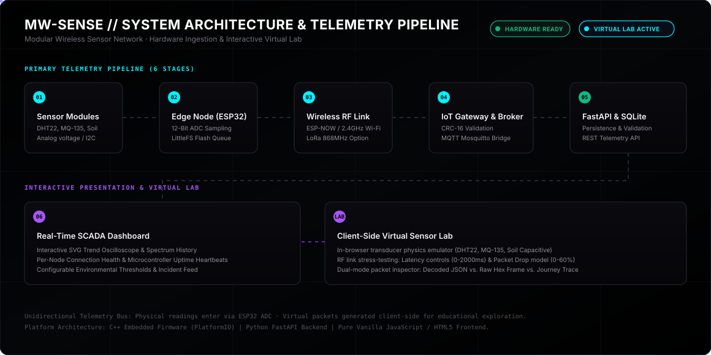

# MW-SENSE

### Modular Wireless Sensor Network & Real-Time Telemetry Platform

[](docs/assets/animations/00-system-architecture.svg)
[-red.svg)](firmware/esp32/)
[](firmware/esp32/)
[](backend/)
[](backend/mqtt_bridge.py)
[](tests/)
[](#interactive-virtual-sensor-lab)
[](LICENSE)

MW-SENSE is an end-to-end modular wireless sensor network (WSN) and environmental telemetry platform developed as an engineering college major project. It bridges physical hardware transducers, microcontroller firmware with flash-based offline buffering, wireless transport protocols, a container-ready telemetry gateway, and an interactive browser-based virtual lab.

The platform provides a dual-mode workflow: it interfaces directly with physical ESP32 sensor nodes over MQTT and Wi-Fi, while offering a self-contained, interactive virtual lab environment so students and evaluators can inspect every stage of the telemetry pipeline without requiring benchtop hardware.

---

## Animated System Architecture

The following dynamic schematic illustrates the telemetry journey across both the physical embedded path and the client-side virtual lab:

<p align="center">
  
</p>

---

## The 6-Layer Architecture Breakdown

MW-SENSE decomposes distributed sensing into six decoupled layers, following standard industrial telemetry and SCADA design principles:

```text
+---------------------------------------------------------------------------------------------------+
| 01. SENSOR TRANSDUCTION LAYER                                                                     |
| Physical environmental inputs converted to analog voltage / capacitance (DHT22, MQ-135, Soil v1.2)|
+---------------------------------------------------------------------------------------------------+
                                                  |
                                                  v
+---------------------------------------------------------------------------------------------------+
| 02. EDGE COMPUTATION LAYER (ESP32)                                                                |
| 12-bit ADC sampling, digital noise filtering, engineering unit calibration, LittleFS flash queue |
+---------------------------------------------------------------------------------------------------+
                                                  |
                                                  v
+---------------------------------------------------------------------------------------------------+
| 03. WIRELESS RF TRANSPORT LAYER                                                                   |
| 2.4 GHz Wi-Fi / ESP-NOW link with CRC-16 checksums, latency modulation, and packet loss handling |
+---------------------------------------------------------------------------------------------------+
                                                  |
                                                  v
+---------------------------------------------------------------------------------------------------+
| 04. IOT GATEWAY & BROKER LAYER                                                                    |
| Packet decryption, checksum validation, metadata envelope wrapping, Mosquitto MQTT pub/sub        |
+---------------------------------------------------------------------------------------------------+
                                                  |
                                                  v
+---------------------------------------------------------------------------------------------------+
| 05. DATA PERSISTENCE & API LAYER                                                                  |
| Python FastAPI service, SQLite WAL persistence, bearer authentication, device credential registry |
+---------------------------------------------------------------------------------------------------+
                                                  |
                                                  v
+---------------------------------------------------------------------------------------------------+
| 06. PRESENTATION & VIRTUAL LAB LAYER                                                              |
| Jet-black obsidian SCADA interface, live RF carrier oscilloscope, dual-mode packet inspector      |
+---------------------------------------------------------------------------------------------------+
```

### 1. Sensor Transduction Layer
Physical environmental properties are transduced into electrical signals:
- **Temperature & Relative Humidity (DHT22 / SHT31)**: Negative Temperature Coefficient (NTC) thermistor resistance decreases non-linearly with heat; relative humidity is measured via a moisture-absorbing capacitive dielectric polymer film.
- **Air Quality & Gas Sensing (MQ-135)**: Heated tin-dioxide ($SnO_2$) semiconductor surface reacts with hazardous gases ($CO_2$, $NH_3$, ethanol, benzene, smoke), lowering surface electrical resistance in direct proportion to gas concentration in parts-per-million (PPM).
- **Soil Moisture (Capacitive v1.2)**: A 1.5 MHz high-frequency oscillator measures soil dielectric permittivity without exposing copper traces to galvanic electrolysis or soil corrosion.

### 2. Edge Node Firmware (`firmware/esp32/`)
The ESP32 edge microcontroller executes C++ firmware built on PlatformIO:
- **Analog-to-Digital Conversion**: Samples sensor lines using the 12-bit SAR ADC (4096 resolution steps across a 0.0V to 3.3V attenuation window).
- **Digital Calibration**: Averages multi-sample windows to reject electrical switching noise and applies polynomial calibration curves to output standard engineering units (°C, %, PPM).
- **LittleFS Offline Ring Buffer**: During wireless disconnections or router dropouts, readings are buffered to flash memory via an offline circular queue (`firmware/esp32/src/main.cpp`). Once connectivity recovers, queued packets flush chronologically with exponential retry backoff.

### 3. Wireless RF Transport Layer
- Telemetry frames are broadcast over 2.4 GHz Wi-Fi (802.11 b/g/n) or low-overhead ESP-NOW peer-to-peer links.
- Frames include 16-bit Cyclic Redundancy Checks (CRC-16) to reject corrupted bytes caused by radio interference or multi-path fading.

### 4. IoT Gateway & Message Broker
- A central gateway node captures raw RF broadcasts and verifies frame integrity.
- Wraps raw telemetry into a versioned Gateway Envelope (`schema_version: 1.0`, `message_type: telemetry.reading`, `received_at: ISO8601`).
- Dispatches messages across the Mosquitto MQTT broker (`mwsense/telemetry/nodes`).

### 5. Application Backend & Data Storage (`backend/`)
- Built with Python and FastAPI, providing OpenAPI-compliant REST endpoints (`/telemetry`, `/devices`, `/health`).
- Telemetry validation verifies device registrations, expected sensor bounds, and parameter definitions before committing records.
- Persists verified time-series readings to SQLite in Write-Ahead Logging (WAL) mode for concurrent read/write throughput.

### 6. Presentation & Virtual Sensor Lab (`index.html`, `styles.css`, `app.js`)
- Styled in high-contrast ZBlack Obsidian (`#000000`) with glassmorphic onyx surfaces and neon cyan/emerald status accents.
- Features a real-time RF carrier oscilloscope, dual-mode packet inspector, and live SVG time-series charts.

---

## Interactive Virtual Sensor Lab

To enable students and visitors to understand how IoT networks function, the browser interface includes an educational virtual lab:

### How Students Can Explore the Data Journey
1. **Interactive Transducer Sliders**: Adjust physical inputs (temperature from 0°C to 50°C, air quality up to 500 PPM, soil moisture from 0% to 100%).
2. **One-Click Real-World Scenario Presets**:
   - `Standard Room`: Baseline room conditions (24.0°C, 50% Hum, 85 PPM, 45% Soil).
   - `Gas Leak Event`: Spikes air quality to 380 PPM to test threshold alert triggers.
   - `Crop Heatwave`: Sets temperature to 42.0°C and soil moisture to 14% to simulate drought conditions.
   - `Monsoon Cloudburst`: Saturates soil moisture to 90% and humidity to 94%.
   - `Cold Storage`: Emulates cold chain refrigeration failure (2.5°C).
3. **RF Signal Carrier Oscilloscope**: A Canvas-driven oscilloscope visualizes the 2.4 GHz radio carrier. When transmission is triggered, the wave modulates into high-frequency RF packet bursts.
4. **Dual-Mode Packet Inspector**:
   - `Decoded JSON`: Human-readable structured payload with timestamps, node ID, parameter, and status.
   - `Raw Hex Frame`: Displays the underlying binary byte layout (`[PREAMBLE] [NODE_ADDR] [PARAM] [FLOAT32_BYTES] [CRC16]`).
   - `Data Journey Trace`: Step-by-step diagnostic breakdown of the 6-stage telemetry journey.
5. **Network Stress Testing**: Adjust latency (0 to 2000 ms) and simulated packet loss probability (0% to 60%) to observe how network congestion affects packet delivery and alert feeds.

---

## Repository Structure

```text
MW-SENSE/
├── index.html                  # ZBlack Obsidian Virtual Lab interface
├── styles.css                  # Pure CSS3 responsive obsidian visual system
├── app.js                      # Client-side telemetry simulation and RF visualizer
├── telemetry-core.js           # Payload validation, repository contracts, and storage adapters
├── package.json                # Node.js test scripts and project metadata
├── requirements-browser.txt    # Browser testing dependencies
├── LICENSE                     # MIT Open-Source License
├── README.md                   # System documentation and engineering specifications
├── backend/                    # Python FastAPI application and MQTT ingestion service
│   ├── main.py                 # FastAPI application factory and REST endpoints
│   ├── database.py             # SQLite WAL database models and migrations
│   ├── mqtt_bridge.py          # Mosquitto MQTT subscriber and telemetry parser
│   ├── backup.py               # Database backup and restore utilities
│   ├── schemas.py              # Pydantic request/response schemas
│   └── tests/                  # Backend unit and integration test suite
├── docs/                       # Architectural documentation and visual assets
│   ├── DEPLOYMENT_CHECKLIST.md # Physical installation and production checklist
│   └── assets/animations/      # Animated SVG architecture diagrams
│       └── 00-system-architecture.svg
├── firmware/esp32/             # PlatformIO embedded C++ firmware for ESP32 nodes
│   ├── platformio.ini          # Board definitions, baud rates, and library dependencies
│   ├── src/main.cpp            # ADC reading, LittleFS queue, and MQTT publisher
│   └── test/native/            # Unit tests for LittleFS offline queue logic
└── tests/                      # Core JavaScript telemetry and storage test suite
    ├── telemetry.test.js       # Payload validation and range boundary checks
    ├── storage.test.js         # LocalStorage adapter and retention limits
    ├── repository.test.js      # Repository abstraction and snapshot export/import
    ├── pipeline.integration.test.js # End-to-end telemetry pipeline verification
    └── browser_smoke.py        # Playwright headless browser smoke test
```

---

## Quickstart & Local Setup

### 1. Launch the Virtual Lab (Zero Dependencies)

No package installation or compiler is required to run the virtual lab interface. Serve the root directory using Python:

```bash
python -m http.server 8000
```

Open your browser at **http://localhost:8000** to access the interactive virtual lab.

### 2. Run the Unit & Integration Test Suite

Verify all 29 telemetry validation, storage, and repository contracts using the built-in Node.js test runner:

```bash
node --test
```

Output:
```text
[PASS] valid sample crosses validation, gateway and storage
[PASS] invalid sample never reaches gateway storage
[PASS] dropped packet is not stored
[PASS] repository validates records before delegating to its adapter
[PASS] repository exports a versioned portable snapshot
...
Tests: 29 passed, 0 failed
```

### 3. Run the Backend Telemetry API (Optional)

To connect the dashboard to a persistent backend service:

```bash
cd backend
python -m venv .venv
source .venv/bin/activate  # On Windows: .venv\Scripts\activate
pip install -r requirements.txt
uvicorn main:app --host 127.0.0.1 --port 8001 --reload
```

Access the OpenAPI documentation at **http://127.0.0.1:8001/docs**.

### 4. Flash ESP32 Hardware Firmware (PlatformIO)

To compile and upload firmware to an ESP32 microcontroller:

```bash
cd firmware/esp32
pio run --target upload
pio device monitor --baud 115200
```

---

## Hardware Pinout Reference (ESP32)

| Node Identifier | Target Sensor | ESP32 GPIO Pin | Protocol / Signal Type | Operating Voltage |
|---|---|---|---|---|
| `NODE-01` | DHT22 Temperature & Humidity | GPIO 4 | 1-Wire Digital Bitbang | 3.3V DC |
| `NODE-02` | MQ-135 Gas & Air Quality | GPIO 36 (ADC1_CH0) | Analog Voltage (0.0V - 3.3V) | 5.0V Heater / 3.3V ADC |
| `NODE-03` | Capacitive Soil Moisture v1.2 | GPIO 39 (ADC1_CH3) | Analog Voltage (1.2V - 2.8V) | 3.3V DC |
| `GATEWAY` | RF Transceiver / Status LED | GPIO 2 (Internal LED) | Digital Output Heartbeat | 3.3V DC |

---

## Offline Resiliency: The LittleFS Queue

In real-world field installations, cellular or Wi-Fi links can fail intermittently. Rather than dropping readings during an outage, the ESP32 firmware executes a LittleFS ring buffer:

1. **State Detection**: If `WiFi.status() != WL_CONNECTED` or the MQTT socket disconnects, the node enters `OFFLINE_BUFFER` mode.
2. **Flash Serialization**: New telemetry readings serialize into compact binary records and append to `/spool/offline.dat` on the internal LittleFS flash partition.
3. **Queue Bounding**: The queue enforces a 100-record threshold to prevent flash exhaustion.
4. **Reconnection & Drain**: When connection recovers, a background worker reads pending records from flash, broadcasts them with their original timestamps, and purges the spool.

---

## License

MW-SENSE is open-source software licensed under the [MIT License](LICENSE). Developed as an academic college project for modular wireless sensor network research and telemetry education.
