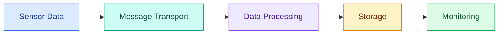
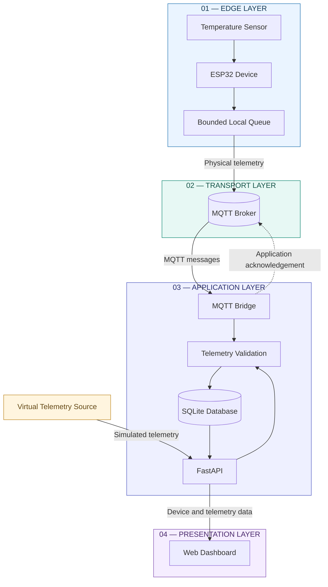
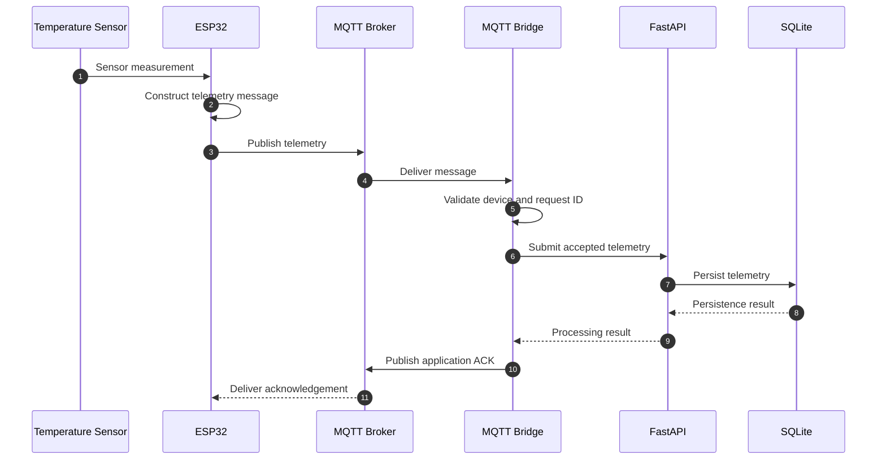
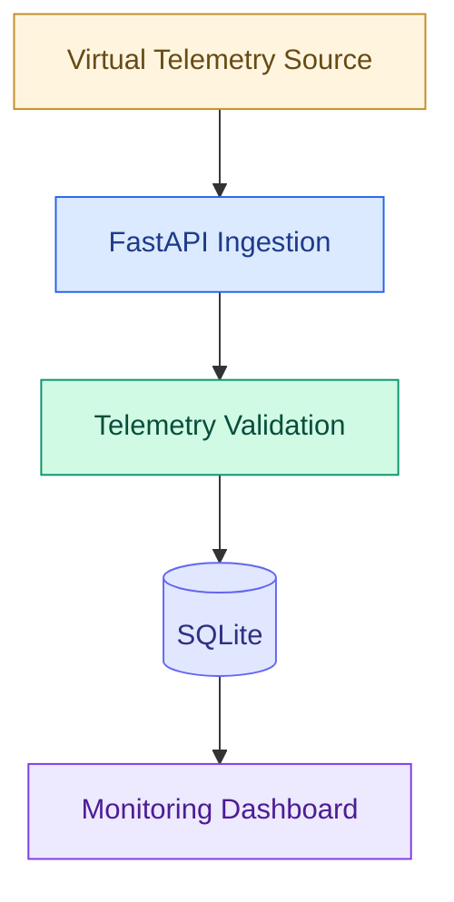
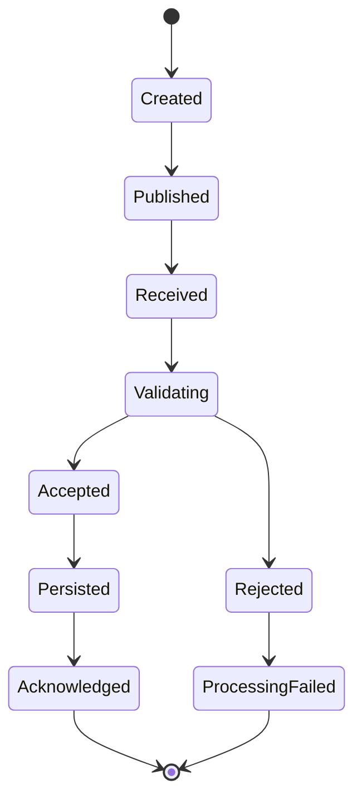

# MW-SENSE

### Modular Wireless Sensor Network & Telemetry Platform

<p align="center">
  <strong>From edge devices to observable telemetry.</strong>
  <br/>
  An IoT platform for sensor communication, telemetry ingestion, and device monitoring.
</p>

<p align="center">
  
  
  
  
  
</p>

<p align="center">
  <a href="#overview">Overview</a> ·
  <a href="#architecture">Architecture</a> ·
  <a href="#data-flow">Data Flow</a> ·
  <a href="#getting-started">Getting Started</a> ·
  <a href="#verification">Verification</a>
</p>

---

## Overview

MW-SENSE is an IoT telemetry platform designed to connect distributed sensor devices to a centralized monitoring system.

It brings together embedded devices, MQTT communication, backend processing, data persistence, and a browser-based dashboard.

The platform supports both physical sensor telemetry and virtual telemetry, allowing application development and testing without requiring connected hardware.

### What happens inside MW-SENSE?



| System component | Technology |
|---|---|
| Edge hardware | ESP32 |
| Communication | MQTT |
| Backend | FastAPI |
| Persistence | SQLite |
| Dashboard | Browser-based JavaScript application |
| Firmware development | PlatformIO |
| Development modes | Physical and virtual telemetry |

---

## Architecture

MW-SENSE is organized into four logical layers. Each layer has a distinct responsibility and communicates through defined interfaces.

### Complete system architecture



### Layer responsibilities

| Layer | Components | Responsibility |
|---|---|---|
| Edge | ESP32, sensor, local queue | Collect and prepare sensor readings |
| Transport | MQTT broker | Transport device messages |
| Application | MQTT bridge, FastAPI, SQLite | Validate, process, and persist telemetry |
| Presentation | Web dashboard | Display device and telemetry information |

### Architectural design

- Physical devices communicate through MQTT.
- The MQTT bridge handles incoming device messages.
- FastAPI provides application-facing functionality.
- Validation takes place before telemetry is accepted.
- SQLite stores application data.
- The dashboard presents information exposed by the backend.
- Virtual telemetry supports hardware-independent development.

---

## Data Flow

MW-SENSE supports two telemetry ingestion paths.

### 1. Physical telemetry

The physical path begins with a sensor connected to an ESP32 device.



**Processing sequence**

1. The sensor provides a measurement.
2. ESP32 firmware constructs a telemetry message.
3. The device publishes the message to its MQTT topic.
4. The MQTT bridge receives the message.
5. The bridge validates the device and message requirements.
6. The backend processes and persists accepted telemetry.
7. The bridge publishes an application-level acknowledgement.
8. The device can use the acknowledgement to manage pending messages.

### 2. Virtual telemetry

Physical hardware is not required for every development activity.

The virtual telemetry path allows the application to receive simulated readings directly through the backend.



Virtual telemetry supports:

- Dashboard development.
- Backend testing.
- Demonstrations.
- Hardware-independent development.
- Reproducible telemetry scenarios.

**Important:** Simulated measurements must remain distinguishable from measurements originating from physical devices.

---

## Message Delivery and Acknowledgements

Reliable telemetry requires more than successful MQTT publication.

MW-SENSE combines transport-level messaging with application-level processing acknowledgements.

### Message lifecycle



### Delivery model

| Mechanism | Purpose |
|---|---|
| MQTT QoS | Transport-level delivery behaviour |
| Stable request ID | Identify individual telemetry requests |
| Application acknowledgement | Communicate backend processing outcome |
| Database uniqueness constraints | Help prevent duplicate records |

The current reference firmware publishes telemetry using MQTT QoS 0.

The MQTT bridge subscribes to telemetry and status topics using QoS 1 and publishes application acknowledgements using QoS 1.

Stable request identifiers and database uniqueness constraints support safe redelivery.

The system does not claim exactly-once delivery across the entire device-to-database pipeline.

---

## Core Capabilities

### Telemetry ingestion

Accept structured telemetry, validate incoming data, and persist accepted records.

### Device communication

Use MQTT topics to organize telemetry, heartbeat, and acknowledgement messages.

### Device monitoring

Process device status and heartbeat information. Device offline state is derived when device information is requested, using the configured offline threshold.

### Local queue management

The ESP32 reference firmware uses bounded local queue storage for pending messages within its supported workflow.

### Virtual telemetry

Exercise application functionality without requiring physical sensors or a deployed device network.

### Browser monitoring

Expose device and telemetry information through the browser-facing dashboard.

---

## Technology Stack

| Component | Technology |
|---|---|
| Edge hardware | ESP32 |
| Firmware | PlatformIO |
| Communication | MQTT |
| Backend framework | FastAPI |
| Runtime | Python |
| ASGI server | Uvicorn |
| Database | SQLite |
| Frontend | JavaScript |
| Testing | Pytest and JavaScript test tooling |

---

## Repository Structure

```text
MW-SENSE/
│
├── backend/
│   ├── tests/
│   ├── mqtt_bridge.py
│   └── requirements.txt
│
├── firmware/
│   └── ESP32 reference implementation
│
├── scripts/
│
├── dashboard/
│
├── package.json
│
├── README.md
│
└── ...
```

The tree shows the principal architectural areas rather than an exhaustive inventory. Consult the repository for the complete current structure.

---

## Getting Started

### Prerequisites

- Python 3.12
- Node.js 22
- npm
- Git
- PlatformIO for firmware development
- MQTT broker for physical device integration

### 1. Clone the repository

```bash
git clone https://github.com/chamanvashishth/MW-SENSE.git
cd MW-SENSE
```

### 2. Set up the backend

Create a virtual environment.

**Windows PowerShell**

```powershell
python -m venv .venv
.venv\Scripts\Activate.ps1
```

**Linux / macOS**

```bash
python3 -m venv .venv
source .venv/bin/activate
```

Install dependencies:

```bash
pip install -r backend/requirements.txt
```

Start FastAPI using the ASGI entry point defined by the current backend implementation.

### 3. Set up the dashboard

```bash
npm install
```

Use the development command defined in `package.json`.

The backend and dashboard are separate development processes. Configure their API origin appropriately.

### 4. Build firmware

Install PlatformIO and run:

```bash
pio run
```

Physical deployment also requires compatible hardware, sensor wiring, Wi-Fi configuration, and MQTT broker credentials.

---

## Configuration

The backend supports environment-based configuration.

| Variable | Purpose |
|---|---|
| `MW_SENSE_API_TOKEN` | Optional API token authentication |
| `MW_SENSE_DB_PATH` | SQLite database location |
| `MW_SENSE_ALLOWED_ORIGINS` | Allowed browser origins |
| `MW_SENSE_RETENTION_DAYS` | Telemetry retention configuration |
| `MW_SENSE_DEVICE_OFFLINE_SECONDS` | Device offline threshold |
| `MW_SENSE_QUEUE_WARNING_DEPTH` | Queue warning threshold |
| `MW_SENSE_RETRY_WARNING_COUNT` | Retry warning threshold |
| `MW_SENSE_WEAK_WIFI_RSSI_DBM` | Weak Wi-Fi signal threshold |
| `MW_SENSE_PENDING_WARNING_SECONDS` | Pending-message warning threshold |

### Example development configuration

```env
MW_SENSE_API_TOKEN=replace-with-a-secure-token
MW_SENSE_DB_PATH=./data/mw-sense.db
MW_SENSE_ALLOWED_ORIGINS=http://localhost:3000
MW_SENSE_RETENTION_DAYS=30
MW_SENSE_DEVICE_OFFLINE_SECONDS=120
MW_SENSE_QUEUE_WARNING_DEPTH=20
MW_SENSE_RETRY_WARNING_COUNT=5
MW_SENSE_WEAK_WIFI_RSSI_DBM=-75
MW_SENSE_PENDING_WARNING_SECONDS=60
```

These values are illustrative development settings, not universal production recommendations.

---

## MQTT Integration

The MQTT bridge connects physical device messages to the backend ingestion workflow.

### Topic contract

| Topic | Direction | Purpose |
|---|---|---|
| `mw-sense/{node_id}/{sensor_id}/telemetry` | Device → backend | Sensor telemetry |
| `mw-sense/{node_id}/status` | Device → backend | Device status and heartbeat |
| `mw-sense/{node_id}/{sensor_id}/ack/{request_id}` | Backend → device | Application acknowledgement |

### Broker configuration

| Variable | Behaviour |
|---|---|
| `MW_SENSE_MQTT_HOST` | Broker hostname |
| `MW_SENSE_MQTT_PORT` | Broker port; default `8883` |
| `MW_SENSE_MQTT_TLS` | TLS enabled by default |

The bridge enforces a maximum JSON payload size of 4096 bytes.

Physical telemetry must satisfy the bridge's device validation requirements and include a stable request identifier.

---

## Verification

Verification is separated by system component.

| Check | Command | Purpose |
|---|---|---|
| Frontend checks | `npm run check` | JavaScript validation |
| Frontend tests | `npm test` | JavaScript regression tests |
| Backend tests | `python -m pytest backend/tests -q` | Backend regression tests |
| Firmware build | `pio run` | ESP32 firmware compilation |

Additional browser and native offline-queue checks are available in the repository.

A passing test suite for one component does not establish end-to-end correctness across the device, messaging, persistence, and dashboard layers.

Report only checks that have actually been executed.

---

## Security and Operational Considerations

MW-SENSE is a reference implementation, not a production security certification.

Before deployment beyond a trusted development environment:

- Configure API authentication.
- Use TLS for MQTT connections.
- Use unique device credentials.
- Restrict broker topics with ACLs.
- Keep secrets out of source control.
- Configure browser origins deliberately.
- Establish database backup and recovery procedures.
- Define retention and storage monitoring policies.
- Validate physical sensor calibration.
- Test reconnect, retry, and offline scenarios.

If `MW_SENSE_API_TOKEN` is unset, token-based authentication is disabled.

CORS is not an authentication mechanism.

Virtual telemetry is not a substitute for calibrated physical measurements.

The current ESP32 reference implementation supports a temperature sensor adapter. Additional sensor types require their own firmware integration and validation.

---

## Engineering Principles

MW-SENSE follows five engineering principles.

| Principle | Application |
|---|---|
| Separation of concerns | Keep device, transport, backend, persistence, and presentation responsibilities distinct |
| Explicit contracts | Define telemetry messages, identities, request IDs, and acknowledgement topics |
| Observability | Make device state, telemetry, and processing outcomes inspectable |
| Testability | Verify backend, frontend, firmware, and transport independently |
| Honest guarantees | Document actual delivery and operational behaviour |

---

## Roadmap

Potential engineering extensions:

- Additional sensor adapters.
- Stronger device provisioning and credential lifecycle management.
- More comprehensive end-to-end telemetry tests.
- Expanded offline and reconnect testing.
- Deployment observability and structured logging.
- Scalable persistence and retention strategies.
- More detailed device health diagnostics.

These are potential extensions, not claims of completed implementation.

---

## Contributing

Contributions should preserve the system's architectural boundaries and existing telemetry contracts.

Before submitting a change:

1. Understand the affected component.
2. Review the existing implementation and tests.
3. Keep changes scoped to a clear responsibility.
4. Add regression coverage.
5. Run the relevant verification commands.
6. Document configuration or contract changes.

For substantial changes, include the motivation, architectural impact, verification performed, and operational trade-offs.

---

## License

Refer to the repository's `LICENSE` file for the applicable licensing terms.

---

<p align="center">
  <strong>MW-SENSE</strong>
  <br/>
  Modular Wireless Sensor Network & Telemetry Platform
  <br/><br/>
  <sub>Connecting edge devices to meaningful telemetry.</sub>
</p>
