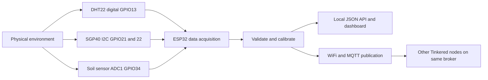

# MW-SENSE

**Modular Wireless Sensor Network for Environmental and Infrastructure Monitoring**

MW-SENSE explores how measurements move from physical sensors into a wireless monitoring system. The project contains two complementary experiences: a browser-based virtual telemetry lab and an ESP32 circuit imported from Tinkered. The new **Sensor Data Journey** page follows each live measurement block by block, so it is possible to inspect where the data comes from and what happens before it reaches the dashboard.

> **Project status:** The Tinkered export reports firmware compilation and structural circuit checks. That is not proof of real-hardware deployment, authenticated backend integration, broker delivery or long-term reliability. The existing browser virtual lab operates on simulated inputs. These modes are intentionally labelled separately.

## 1. The problem

Environmental monitoring in laboratories, classrooms, farms and facilities is often manual or split between different instruments. Periodic checks can miss changes. A fixed sensor assembly can also be difficult to expand. MW-SENSE investigates a reusable path from **sensors → microcontroller → validation → wireless telemetry → monitoring**, with a design that can accommodate additional nodes.

## 2. What this repository contains

| Part | Purpose | Measurement source |
|---|---|---|
| `index.html`, `app.js`, `styles.css` | Existing interactive virtual lab with an educational telemetry pipeline | Explicitly simulated inputs |
| `firmware/esp32/` | Existing ESP32 embedded implementation | Device readings from its own configured sensor and pinout |
| `backend/` | Existing FastAPI application, persistence and authenticated MQTT ingestion | Requests accepted under the existing backend schema |
| `simulator/tinkered/` | **New imported ESP32 DevKit V1 circuit, firmware and Tinkered export metadata** | DHT22, SGP40 and capacitive soil probe |
| `simulator/tinkered/src/trace.h` | **New live block by block Sensor Data Journey** served at `/trace` | Data read from the ESP32's real `/api/nodes` response |
| `docs/SENSOR_DATA_FLOW.md` | Signal paths, pin map, validation rules, MQTT topics and experiments | Verified against the Tinkered export and firmware |

**Important:** The two ESP32 firmware variants use different pins and different MQTT topics. They are not drop-in replacements. The current FastAPI MQTT bridge does **not** ingest the Tinkered aggregate telemetry schema without an adapter and registered credentials.

## 3. Architecture: from environment to dashboard



The live trace on the device is reached through the ESP32's IP address, not GitHub Pages. It shows actual API values and the last JSON accepted by the local MQTT publishing call. It does not invent missing measurements.

### Block 1: Sensors

| Sensor | What it measures | ESP32 connection | Update interval |
|---|---|---|---|
| DHT22 | Temperature and relative humidity | DATA to **GPIO13**, 10 kΩ pullup | 2500 ms |
| SGP40 | **Relative VOC index** with environmental compensation | SDA **GPIO21**, SCL **GPIO22**, I²C 0x59 | 1000 ms |
| Capacitive soil v1.2 | Raw analog soil-probe output | AOUT to **GPIO34** (ADC1) | 1000 ms |

All sensors use the **3.3 V** rail and common ground in this Tinkered design. An SGP40 VOC index is **not** AQI, CO2 concentration or a pollutant PPM reading. Soil moisture percentage requires calibration with the actual probe and soil.

### Block 2: Read the values on ESP32

`sampleRoom()` reads DHT22, `sampleAir()` measures the SGP40 VOC index, and `sampleSoil()` reads and averages 16 ADC measurements. The ESP32 does this before values are sent anywhere else.

### Block 3: Check readings

DHT22 readings are checked against expected temperature and humidity limits. SGP40 can report `warming_up`. Soil ADC rail errors and calibration-range errors are reported. Sensor records preserve `status`, `age_ms`, `error_count` and `last_good_value`. Unhealthy `value` fields are `null` rather than old readings presented as current.

Soil percentage in the exported firmware uses the editable endpoints **dry = 3723** and **wet = 1489** ADC counts:

```text
percent = round(100 * (raw_adc - dry_adc) / (wet_adc - dry_adc))
```

### Block 4: Publish over MQTT

The Tinkered device sends a node-level JSON message to `mw-sense/<node_id>/telemetry` every five seconds when connected. It publishes retained online and offline status to `mw-sense/<node_id>/status`. A designated dashboard host also subscribes to other nodes using those topics. This schema differs from the existing backend's per-sensor MQTT topic and validation format.

### Block 5: View the measurements

- `http://<ESP32-IP>/` shows current device measurements and status.
- `http://<ESP32-IP>/trace` shows the **new block by block journey**, the GPIO source for every value, validation status, current JSON API snapshot and most recent successful MQTT publish payload.
- `http://<ESP32-IP>/api/nodes` returns live node records.
- `http://<ESP32-IP>/api/last-published` returns the last locally successful MQTT payload, or a `no_mqtt_publish_yet` marker.

The API is polled by the browser every two seconds. A successful `mqtt.publish()` call is not equivalent to independent broker delivery confirmation.

## 4. Run the browser virtual lab

The original site can be used without hardware. Clone the repository, then from its root run:

```bash
python -m http.server 8000
```

Open **http://localhost:8000** and use the virtual lab to explore simulated sensing, wireless transport and the packet journey. For the tests that already ship with the browser project:

```bash
node --test
```

The virtual lab's controls **simulate conditions**. They do not directly read the ESP32's GPIO pins or automatically subscribe to the Tinkered firmware's MQTT messages.

## 5. Run the Tinkered ESP32 circuit

1. Open the files in `simulator/tinkered/` in a compatible Tinkered environment, or use PlatformIO to build the provided `esp32dev` configuration for a real ESP32 board.
2. Review `simulator/tinkered/wiring/wiring.json` and `simulator/tinkered/schematic/main.sch` before assembly. It uses a 3.3 V rail and common ground.
3. Set the WiFi credentials and broker settings in `simulator/tinkered/src/config.h`. These are placeholder values in the imported export and **must** be edited for real hardware.
4. If using PlatformIO, run:

```bash
cd simulator/tinkered
pio run -e esp32dev
pio run -e esp32dev -t upload
pio device monitor -b 115200
```

5. Open the ESP32 IP address printed in the Serial Monitor and visit `/trace` for the complete live sensor journey. Confirm the observed readings against the simulator or the physical sensors.

**Security:** The Tinkered export defaults to plaintext MQTT on port 1883 and a read-only HTTP dashboard. Its example broker configuration is for demonstrations and trusted networks, not a production deployment. Do not expose the ESP32 HTTP server to the public Internet. The existing authenticated backend cannot be safely connected merely by changing a topic string.

## 6. Understand the two firmware profiles

| Detail | Existing `firmware/esp32` implementation | Added `simulator/tinkered` implementation |
|---|---|---|
| Primary purpose | Existing node and backend integration | Exact Tinkered circuit with live on-device dashboard |
| Sensor wiring | Defined by the original firmware | DHT22 13, SGP40 21 and 22, soil 34 |
| MQTT message topic | `mw-sense/{node_id}/{sensor_id}/telemetry` | `mw-sense/{node_id}/telemetry` |
| Payload | One authenticated sensor reading under the backend contract | Aggregated five sensor readings and node status |
| MQTT interoperability | Matches existing MQTT bridge contract | Needs a validated translation and device authentication |
| Browser view | Existing virtual lab | ESP32 on-device `/` and `/trace` |

Keep these as separate profiles until a tested protocol adapter is built. Do not copy sensor settings between them without checking both firmware and physical wiring.

## 7. Research gap and next experiments

Integrating one sensor is not the hardest part. Important open questions are whether several inexpensive nodes remain dependable when WiFi fails, sensor readings become invalid, calibration changes or a broker stops responding. The next steps are to measure data completeness, recovery after disconnection, end-to-end latency and multi-node reliability in controlled physical tests. The Tinkered example is an educational starting point, **not yet experimental evidence** of these performance targets.

## 8. Project directory

```text
MW-SENSE/
├── index.html                 Existing virtual lab
├── app.js and styles.css      Virtual lab interface
├── backend/                   API, MQTT ingestion, database
├── firmware/esp32/            Existing embedded profile
├── tests/                     Existing browser tests
├── simulator/tinkered/        Imported sensor circuit and embedded firmware
│   ├── platformio.ini
│   ├── src/
│   │   ├── main.cpp           Sensor sampling, validation, networking, routes
│   │   ├── config.h           GPIO, broker and calibration settings
│   │   ├── dashboard.h        Local live values
│   │   └── trace.h            NEW: sensor data journey page
│   ├── wiring/wiring.json
│   ├── schematic/main.sch
│   ├── specs/bom.json
│   ├── design/spec.json
│   ├── docs/steps.json
│   └── README.md              Exact Tinkered build notes
└── docs/SENSOR_DATA_FLOW.md   Stepwise explanation and experiments
```

## 9. Technical references

The following are manufacturer, standards or implementation documentation. They explain the hardware and protocols, and are not claims that the project has passed hardware tests.

1. [Espressif: ESP32-DevKitC hardware and pin reference](https://documentation.espressif.com/esp-dev-kits/en/latest/esp32/esp32-devkitc/user_guide.html)
2. [Espressif: ESP32 ADC documentation](https://docs.espressif.com/projects/esp-idf/en/stable/esp32/api-reference/peripherals/adc/index.html)
3. [Adafruit: DHT temperature and humidity sensor guide](https://learn.adafruit.com/dht)
4. [Adafruit: SGP40 Arduino guide](https://learn.adafruit.com/adafruit-sgp40/arduino)
5. [Sensirion: SGP40 sensor](https://sensirion.com/products/catalog/SGP40)
6. [PlatformIO: Espressif ESP32 Dev Module](https://docs.platformio.org/en/stable/boards/espressif32/esp32dev.html)
7. [OASIS: MQTT Version 5.0 standard](https://docs.oasis-open.org/mqtt/mqtt/v5.0/mqtt-v5.0.html)
8. [ArduinoJson documentation](https://arduinojson.org/)
9. [PubSubClient MQTT library](https://pubsubclient.knolleary.net/)

## 10. Credits and license

MW-SENSE is an academic IoT and wireless sensor network project. The original repository's license and contributor history remain intact. The new Tinkered folder is based on the user-provided simulator export, with a documented trace view added for teaching how sensor readings are acquired, validated and published.
